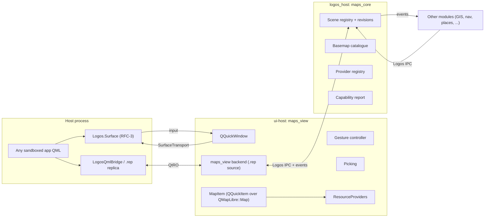

# Logos Maps — Architecture Specification

| | |
|---|---|
| Status | Draft 0.1 — for review |
| Applies to | `maps_core` (headless scene owner, runs in `logos_host`), `maps_view` (out-of-process renderer, runs in `ui-host`), the generic surface-embedding contract they require of the view runtime, and the `maplibre-native-qt` patch set they depend on |
| Normative language | RFC 2119 (MUST / SHOULD / MAY). Requirements in this document are numbered `M<section>.<n>`. Requirements that fall on the *platform* (view runtime, Basecamp) rather than on the maps modules are numbered `RFC-<n>` and are proposals to those repositories, not obligations this repository can discharge alone. |
| Companions | `references/initial-discussion.md` (DISC) records the research that led here. The GIS module is specified separately; §13 fixes only the seam it consumes. The quests specification (`repos/logos-quests/docs/backend-architecture.md`) is the house style this document follows. |

## 0. Reading guide

### 0.1 Why this document exists

Three facts set the shape of a Logos map module and none of them is a map question. First, the platform isolates modules in processes: a `ui_qml` view's QML runs inside Basecamp under a sandbox that forbids native code from the module's install directory, while the view's C++ backend runs in a separate `ui-host` process that has no GUI at all (§1.1). A GPU-rendered map item therefore has no legal home today. Second, every call across the module boundary is a blocking remote call with a hard argument limit and a 20–30 s timeout (§1.2), so a map API designed as "one call per feature" is unusable. Third, the only vector-map engine that is open, cross-platform, GPU-accelerated and already bound to Qt — MapLibre Native Qt — exposes neither feature picking, nor feature state, nor a byte-returning tile provider, nor a usable Quick item (§5, §14).

The resolution this document commits to is: **the map is rendered in the module's own process and composited into the host like any other window; the scene other modules see is a retained, versioned registry owned by a headless core; and tiles, glyphs and styles reach the renderer through a provider seam that the module controls.** Nothing of the maps module — QML or native — ever executes inside Basecamp. §3 derives the hosting model from the platform's own container abstraction; §4–§12 specify the modules; §14 specifies the engine patches; §16 says how to prove it.

### 0.2 How to read the citations

Every claim borrowed from, or checkable against, another project is cited as `<alias> <path>:<lines>`, where `<alias>` resolves through the table below to a repository **pinned at a commit**. The pinned clone is present under `references/` (gitignored private research corpus, populated by `references/clone.sh`) or under the workspace `repos/`. Line ranges were taken on 2026-10-25. Appendix A carries the complete index so that a reader without the clones can follow the argument.

| Alias | Repository @ commit | Local path (from `repos/logos-maps/`) | Role in this document |
|---|---|---|---|
| **DISC** | this repository, `references/initial-discussion.md` | `references/initial-discussion.md` | The research discussion: candidate survey (lines 126–420), source-derived module API (457–1125), GIS boundary (1131–2158), GIS module draft (2164–3352) |
| **MLNQT** | `maplibre/maplibre-native-qt` @ `c3485f3` (v4.0.0 dev, BSD-2) | `references/maplibre-native-qt/` | The engine binding: `QMapLibre::Map`, `Settings`, render threading, `MapQuickItem`, Qt Location plugin. Vendors mbgl at `702ebc6` (submodule not checked out; cite MLN) |
| **MLN** | `maplibre/maplibre-native` @ `36132b0` (BSD) | `references/maplibre-native/` | The engine core (`mln::` namespace at this commit): `Map`, `Renderer`, style, storage/file sources, Qt platform build, Android gesture stack |
| **MGQ** | `rinigus/mapbox-gl-qml` @ `79e0ccc` (LGPLv3) | `references/mapbox-gl-qml/` | Retained-asset replay after style reload, render-thread query/reply, three-ratio pixel model, FBO texture node, legacy gesture area |
| **PM** | `rinigus/pure-maps` @ `a830199` (GPL-3) | `references/pure-maps/` | Basemap descriptor schema, profiles, label-layer anchors, loopback-HTTP offline provider, attribution UI |
| **VELA** | `vela` @ `090d1e1` | `references/vela/` | Requirements (FEATURES.md, SPEC.md §6–§7), gesture tuning against real users, layer lifecycle, offline PMTiles interception, picking |
| **QF** | `opengisch/QField` @ `9da7181` (GPL-2+) | `references/qfield/` | Qt 6 pointer-handler gesture design: device-class split, freeze ref-count, kinetic inertia, double-tap-drag zoom |
| **QTLOC** | `qt/qtlocation` dev @ `b992b42` | `references/qtlocation/` | Removal of the built-in gesture area; pointer-handler idiom; `QGeoMap` contract |
| **OSMS** | `Framstag/libosmscout` @ `512c69b` | `references/libosmscout/` | Comparison only (own renderer, Qt5 touch handling) |
| **MARBLE** | `KDE/marble` @ `d79fdf8` | `references/marble/` | Comparison only (no multi-touch) |
| **PMT** | `protomaps/PMTiles` @ `aec8fa1` | `references/pmtiles/spec/v3/spec.md` | Archive format v3 |
| **MBT** | `mapbox/mbtiles-spec` @ `682fed7` | `references/mbtiles-spec/1.3/spec.md` | Archive format 1.3 |
| **OFM** | `hyperknot/openfreemap` @ `0381d4d` | `references/openfreemap/` | Default public tile host; self-hosting; PMTiles/MBTiles planet dumps |
| **OFMS** | `hyperknot/openfreemap-styles` @ `6e53612` | `references/openfreemap-styles/` | Liberty/Bright/Positron/Fiord/Dark styles; shared `openmaptiles` source, glyph and sprite URLs |
| **STYLE** | `maplibre/maplibre-style-spec` @ `6c90d45` | `references/maplibre-style-spec/src/reference/v8.json` | Source and layer types |
| **BC** | `logos-co/logos-basecamp` @ `5454a52` | `../logos-basecamp/` | Process model, QML sandbox, Wayland/EGL runtime |
| **LVMR** | `logos-co/logos-view-module-runtime` @ `a04b463` | `../logos-view-module-runtime/` | `ui-host`, `ViewModuleHost`, `LogosQmlBridge` |
| **LVM** | `logos-co/logos-view-module` @ `8fd4811` | `../logos-view-module/` | `LogosUiPluginContext` |
| **LMB** | `logos-co/logos-module-builder` @ `6e3f7a5` | `../logos-module-builder/` | Templates, `metadata.json` keys, `nix.packages`, `external_libraries` |
| **SDK** | `logos-co/logos-cpp-sdk` @ `3bf5365` | `../logos-cpp-sdk/` | `LogosModuleContext`, `logos_events`, `bind_<iface>()`, type surface, nixpkgs pin |
| **PROTO** | `logos-co/logos-protocol` @ `9d59f5d` | `../logos-protocol/` | Call timeouts, frame size |
| **LIDL** | `logos-co/logos-lidl` @ `5941b8f` | `../logos-lidl/` | Contract type surface |
| **LIB** | `logos-co/logos-liblogos` @ `9603255` | `../logos-liblogos/` | `ModuleContainer` seam (subprocess / in-process), iOS limits |
| **STORAGE** | `logos-co/logos-storage-module` @ `7548f41` | `../logos-storage-module/` | CID blob store used by the `logos://` provider |
| **LGX** | `logos-co/logos-package` @ `e8aa6ef` | `../logos-package/` | `.lgx` assets |
| **MAPS** | this repository (`0xc1c4da/logos-maps`) @ `daa36ba` | `core/`, `ui/` | The draft API this document replaces (§12) |

A citation without a line range names a whole file. `VELA VelaMapView.kt` abbreviates `VELA app/src/main/java/app/vela/ui/map/VelaMapView.kt`; `VELA SPEC` abbreviates `VELA SPEC.md`; `VELA FEAT` abbreviates `VELA FEATURES.md`; `MLN android/...` abbreviates `MLN platform/android/MapLibreAndroid/src/main/java/org/maplibre/android/...`.

### 0.3 Structure

§1 forces → §2 glossary → §3 hosting model (where the renderer runs) → §4 module family and boundaries → §5 engine contract → §6 retained scene → §7 camera and projection → §8 interaction (gestures, picking) → §9 basemaps and styles → §10 resource providers → §11 capabilities and errors → §12 public API → §13 GIS seam → §14 `maplibre-native-qt` patch set and build → §15 non-functional → §16 conformance → §17 open issues → §18 traceability → §19 revision history. Appendix A: donor line indexes. Appendix B: gesture constants. Appendix C: basemap descriptor schema. Appendix D: engine API inventory.

---

## 1. Problem and forces

### 1.1 The platform's process model

| Fact | Evidence | Consequence |
|---|---|---|
| A Logos module runs in its own `logos_host` process and is reached only over IPC | BC `docs/spec.md:37`; LIB `docs/spec.md:28–29, 59` | `maps_core` is a headless process. Its API is the only thing other modules can see |
| A `ui_qml` view's **QML** runs inside the Basecamp process in a `QQuickWidget`; its **C++ backend**, if any, runs in a child `ui-host` process reached over Qt Remote Objects | BC `app/PluginLoader.cpp:371–387, 450–527`; BC `app/UIPluginManager.cpp:882–890`; LMB `README.md:122–124`; LVMR `include/LogosQmlBridge.h:40–43` ("no code from the module is loaded into the host") | A view's QML and its C++ are in different processes by construction |
| `ui-host` is a `QCoreApplication`: it has no window, no scene graph, no GPU context | LVMR `ui-host/main.cpp:98` | Nothing can be rendered in the module's process today |
| The sandboxed QML engine keeps the module's install directory off the native-plugin search path and rejects any `qmldir` under the module's roots that declares a native `plugin` (regression F-008) | BC `app/restricted/QmlSandbox.cpp:36–44`; BC `app/restricted/RestrictedUrlInterceptor.h:22–30`; BC `docs/spec.md:215–221` | A module cannot bring a C++ `QQuickItem` into Basecamp's scene, and MUST NOT try to; the sandbox is the isolation guarantee of the whole platform |
| The sandbox installs a deny-all network manager and allow-listed file roots | BC `docs/spec.md:219`; BC `app/restricted/QmlSandbox.cpp:45, 58–66` | Tiles cannot be fetched by QML in the host; they must be fetched where the renderer runs |
| A UI plugin "is a view, not a module": it has no module identity, only a dependency surface and `onContextReady()` | LVM `cpp/logos_ui_plugin_context.h:10–17`; LMB `doctests/ui-typed-backend.test.yaml:17–24` | Anything other modules must address lives in `maps_core`, never in the view |
| liblogos abstracts *how* a module is contained: `ModuleContainer` has a subprocess implementation today and names in-process and sandboxed containers as sibling implementations; iOS cannot spawn processes | LIB `docs/spec.md:20, 29, 51, 100, 321`; LIB `docs/spec.md:231` ("Not available on iOS") | The hosting model of §3 is written against a *container* seam, so the per-OS decision (process vs in-process) is the platform's and applies uniformly to modules and views |

### 1.2 The IPC boundary

| Fact | Evidence | Consequence |
|---|---|---|
| Methods and `.rep` slots carry at most four arguments; structured data crosses as JSON text or bytes | MAPS `ui/src/maps_ui.rep:5–6`; `repos/logos-quests/README.md:76–82` | Scene changes are batches, not calls per feature (§6) |
| The boundary type surface is `bool, int64, uint64, double, string, vector, map, optional, bytes`; universal cores are Qt-free | LIDL `docs/spec.md:179–187, 208–210`; SDK `README.md:434–437` | `maps_core` is `lp`-style C++ with no Qt; geometry is GeoJSON text or packed bytes |
| A synchronous call made from inside an event callback or `onContextReady()` blocks until the timeout (20 s protocol default; 30 s observed in Qt API clients) and returns a default | PROTO `cpp/logos_mode.h:29–31`; MAPS `ui/src/maps_ui_backend.h:39–44`; `.cursor/skills/logos-basecamp-module/SKILL.md:194–196` | Every cross-module call from a reaction MUST be deferred (M12.9); picking and scene updates are event-driven |
| Frames are length-prefixed with a 4-byte big-endian length | PROTO `cpp/implementations/plain/rpc_framing.h:16–18` | No protocol-level cap below ~4 GiB; payload size is a memory policy (§15.3), not a framing limit |
| Events are declared in a `logos_events:` section of the universal impl header and emitted through the host | SDK `cpp/logos_module_context.h:10–27, 58–67, 232–252`; SDK `README.md:347–373, 477–496` | `maps_core` publishes scene and interaction events; views subscribe |

### 1.3 The engine

MapLibre Native is the only candidate that is open, GPU-accelerated, vector-capable, cross-platform and already bound to Qt 6 (DISC 126–215 ranks it first; §4 of DISC and this document's §5 reject Qt Location raster, QGIS, libosmscout and Marble as *the* renderer). Its Qt binding, however, lacks the four things a shared map module needs most — rendered-feature queries, feature state, a byte-returning resource provider, and a production-grade Quick item (MLNQT `src/core/map.hpp:34–226`; absence confirmed by search across the tree, Appendix D) — while the core has all of them (MLN `include/mln/renderer/renderer.hpp:55–90`, `include/mln/storage/file_source_manager.hpp:37–44`). The engine is therefore used **unforked** and the binding is **patched** (§14).

### 1.4 What the maps module is, and is not

The maps module family is a **rendering and interaction service**: it owns the visual representation of geographic content, the camera, picking, and the sources from which the renderer loads bytes. It is not a data product. Routing, geocoding, places, transit, traffic, downloads, region catalogues, GIS processing (CRS, geometry, editing) and tile production are separate modules that *draw through* the maps API (DISC 1743–1760, 2146–2158; VELA requirement classes in §18.1).

### 1.5 Non-goals

- Any execution of maps code inside Basecamp (QML, C++ or QML plugin). Not as an option, not as a fallback.
- A second renderer (QGIS canvas, Qt Location items, libosmscout) behind the same API (DISC 1762–1812, "Path A only").
- Arbitrary display projections. The rendered map is Web Mercator; other CRSs are input to the GIS module (DISC 2112–2122).
- On-device vector-tile encoding of large datasets in the first release (DISC 2941–2945).
- Owning routing, search, places, offline-region management or tile hosting.

---

## 2. Glossary

| Term | Meaning |
|---|---|
| **Host** | The application that shows a map: Basecamp, `logos-standalone-app`, or any program linking the view runtime |
| **`maps_core`** | The headless Logos module (type `core`, interface `universal`) that owns the retained scene, basemap catalogue, provider registry and capability report, and emits scene/interaction events. Runs in `logos_host` |
| **`maps_view`** | The view module (type `ui_qml` with C++ backend) that renders the scene with MapLibre, owns gestures and picking, and exposes a `.rep` surface to the host. Its C++ runs in `ui-host`; its *window* is composited into the host (§3) |
| **Session** | A namespace inside the scene owned by one client module (`<module>/<name>`); all ids a client creates are prefixed by it (DISC 563–574) |
| **Scene** | The set of sources, layers, images, filters and property overrides that `maps_core` holds for all sessions, independent of whether any view is open |
| **SceneBatch** | One ordered list of scene operations applied atomically and acknowledged with a revision |
| **Basemap descriptor** | A JSON record naming a style (URL or inline), its sources, attribution, anchors and profiles (§9) |
| **ResourceProvider** | An implementation of the engine's `FileSource` contract that answers `Resource` requests with bytes for one URL scheme or host (§10) |
| **SurfaceTransport** | The mechanism by which a `maps_view` window becomes visible inside a host window across a process boundary (§3) |
| **ViewContainer** | The platform's decision, per OS, whether a view runs as a subprocess composited through a `SurfaceTransport` or in-process (§3.1), mirroring LIB `ModuleContainer` |
| **Picking** | Querying rendered features at a screen point or rectangle and resolving them to `(session, layer, feature id)` |
| **Capability** | A boolean or scalar the view reports about what it can do on this device (backend, picking, feature state, PMTiles, transport) |

---

## 3. Hosting model

### 3.1 The container seam

**M3.1** A `maps_view` MUST render into a `QQuickWindow` that it owns, using its own GPU context, in the process the platform's view container assigns to it. The maps modules MUST NOT depend on which container is in use; the same binary serves both containers below.

**M3.2** The platform (not this module) selects a **ViewContainer** per operating system, mirroring the module container seam liblogos already defines (LIB `docs/spec.md:20, 29, 51, 321`: subprocess today, in-process and sandboxed as sibling implementations):

| ViewContainer | Where the view's window lives | How it reaches the host | Applies to |
|---|---|---|---|
| **Subprocess + SurfaceTransport** (normative default) | the `ui-host` child process | the child's window is a client surface composited by the host (§3.2) | Linux desktop now; macOS/Windows when a transport exists (§17) |
| **In-process** | the host process | the view's `QQuickItem` is instantiated directly | Only where the OS forbids processes and the platform has *already* chosen the in-process `ModuleContainer` for modules (iOS: LIB `docs/spec.md:231`; Android follows) |

The in-process container is a platform policy for operating systems without process isolation; it is not a hosting option on desktop and this document never relies on it. On desktop the only legal container is the first row.

**M3.3** No maps QML, C++ or QML plugin is ever loaded into a host process under the subprocess container. The sandbox rules of BC `app/restricted/QmlSandbox.cpp:36–44` and `RestrictedUrlInterceptor.h:22–30` are preserved unchanged.

### 3.2 SurfaceTransport

**M3.4** A **SurfaceTransport** moves a GPU-rendered surface from the view process to the host and moves input the other way. It MUST provide: (a) zero-copy or single-copy frame delivery; (b) forwarding of pointer, touch (all contact points, with ids and states), wheel and keyboard events into the surface; (c) size, device-pixel-ratio and visibility propagation host → view; (d) frame-callback pacing so the view renders only when the host will display.

**M3.5 Transport 1 — Wayland nested compositor (Linux).** The host runs a `QtWaylandCompositor` on a private socket; the view process connects as an ordinary Wayland client and its toplevel is shown by a `ShellSurfaceItem` inside the host's tab. Precedent: Qt Application Manager hosts separate-process applications exactly this way (nested `WaylandCompositor` + `WaylandOutput` bound to the host window + `ShellSurfaceItem` per surface; see the "Application Features" example in the Qt Application Manager documentation). Touch is forwarded whole by `QWaylandTouch::sendFullTouchEvent(surface, QTouchEvent*)`; buffers are shared via `linux-dmabuf-unstable-v1` (hardware integration), with `wl_shm` as the automatic fallback. Basecamp already ships `qtwayland` and runs on Wayland with mesa/glvnd (BC `nix/app.nix:159–169, 707–720`), so no new runtime dependency is introduced.

**M3.6 Fallback transports.** macOS `IOSurface`, Windows shared `HWND`/DXGI, and a shared-memory pixel copy are *additional* `SurfaceTransport` implementations, not redesigns. The shm transport is the only one permitted to copy pixels and MUST be reported as `transport: "shm"` in capabilities (§11) so hosts can lower frame-rate expectations.

**M3.7 Performance expectations (informative).** Under Transport 1 the per-frame overhead relative to an in-process item is one textured quad in the host scene graph and one compositor hop of latency (one host frame, ≈16 ms at 60 Hz). Gesture → camera → render has no IPC on its path (§8). Tile fetch → GPU upload has no IPC on its path except the `logos://` provider (§10.4). Under the shm fallback the cost is one full-frame copy per frame (≈15 MB at 2560×1440).

### 3.3 Required platform changes (RFC, for `logos-view-module-runtime` and `logos-basecamp`)

These are generic — nothing in them is map-specific — and belong to the view runtime, which already owns the spawn and bridge for view backends (LVMR `README.md:1–60`).

| Id | Change | Where (today) | Notes |
|---|---|---|---|
| **RFC-1** | `ui-host` MUST be able to run as a `QGuiApplication` when the plugin requests a window (`metadata.json` `"view_surface": true`), selecting `-platform wayland` and the compositor socket from its environment | LVMR `ui-host/main.cpp:98` (`QCoreApplication`) | Headless plugins keep `QCoreApplication` |
| **RFC-2** | `ViewModuleHost::spawn` MUST advertise the host's nested-compositor socket (`WAYLAND_DISPLAY=<logos-view-<pid>>`, `QT_WAYLAND_SHELL_INTEGRATION=xdg-shell`, `QT_WAYLAND_DISABLE_WINDOWDECORATION=1`) to the child and, after `READY`, wait for the surface to be mapped before emitting `ready()` | LVMR `src/ViewModuleHost.cpp:83–121, 175–185` | Same `READY` protocol; one extra stage |
| **RFC-3** | The view runtime MUST provide a module-agnostic `Logos.Surface { module; session }` QML item (host side) that embeds the named view module's surface, forwards input, propagates size/DPR/theme, and is itself usable from sandboxed QML (it is vetted host code under `appLibDir`, BC `app/restricted/QmlSandbox.cpp:58–66`) | LVMR (new) | This is how *any* app embeds a map without importing maps code |
| **RFC-4** | Basecamp's `ui_qml` loader MUST, for a view declaring `view_surface`, create the `Logos.Surface` tab content instead of a QML file, keeping the existing bridge (`logos.module(name)`) for the `.rep` replica | BC `app/PluginLoader.cpp:333–448` | The view may still ship optional sandboxed QML for chrome around the surface |
| **RFC-5** | Theme (`Logos.Theme` palette, spacing, typography) and scale MUST be propagated to the view process over the existing bridge as JSON, since the design system's static QML module is registered only in the host (BC `nix/app.nix:905–911`) | LVMR bridge | The view renders its own chrome with Qt Quick Controls styled from that JSON |
| **RFC-6** | The in-process `ViewContainer` for iOS/Android MUST be selected by the same policy that selects liblogos's in-process `ModuleContainer`, never independently | LIB `docs/spec.md:321` | Keeps isolation decisions in one place |

Until RFC-1–4 land, `maps_view` is developed and tested as a standalone Qt application window (its `QQuickWindow` shown directly) and as a Wayland client of a test compositor (§16.6). The maps modules' own code is identical in both.

---

## 4. Module family and boundaries

### 4.1 The two modules



**M4.1 `maps_core`** (type `core`, interface `universal`, Qt-free) is the single addressable surface of the family. It MUST hold, independently of any view: the retained scene for all sessions (§6); the basemap catalogue (§9); the provider registry and policy (§10); the aggregate capability report of connected views (§11); camera *intents* (fly/ease/fit requests addressed to a view id); and it MUST emit the event vocabulary of §12.4. It exists so that scene state is created before a view opens, survives a view closing, and can be driven headlessly under `logosctl` (`.cursor/skills/logos-headless-logosctl/SKILL.md:79–86`).

**M4.2 `maps_view`** (type `ui_qml` with C++ backend, `view_surface: true` per RFC-1) MUST contain: the `QQuickWindow`; the `MapItem` (§5); the gesture controller (§8.1); picking (§8.3); the built-in collections (location puck, scale bar, compass, attribution — §6.7); snapshot rendering; and the provider implementations (§10). It connects to `maps_core` as a subscriber of scene revisions and a publisher of interaction events. Several `maps_view` instances MAY exist (one per host window or embedding); each has a `viewId`.

**M4.3** Nothing in `maps_view` is addressable by other modules except through `maps_core` events and the host-side `.rep` replica (`logos.module("maps_view")`), which is reserved for the host that embeds it. Other modules MUST NOT depend on `maps_view` (LVM `cpp/logos_ui_plugin_context.h:10–17`).

### 4.2 In / out table

Derived from DISC 1743–1760 (two cooperating modules) and 2146–2158 (final architecture decision), and from classifying Vela's map-facing features (§18.1: `[render]`, `[overlay]`, `[gesture]`, `[camera]` are in; `[data]` is out).

| Concern | `maps_core` | `maps_view` | Out (separate module) | Grounds |
|---|---|---|---|---|
| Scene registry, sessions, revisions, replay | owns | applies | — | MGQ `src/sync.h:12–23`; DISC 945–961 |
| Basemap descriptors, style patching rules | owns | executes patch at load | — | PM `maps/*.json`; VELA `MapFonts.kt` |
| Provider registry (which schemes/hosts, cache policy) | owns | instantiates `FileSource`s | archive *download*/region catalogue (data manager) | MLN `main_resource_loader.cpp:69–117`; VELA SPEC 4086–4122 |
| Rendering, GPU, texture node | — | owns | — | MLNQT `src/core/map_renderer.cpp` |
| Gestures, inertia, thresholds | — | owns | — | QF `QfMapCanvas.qml`; MLN android `MapGestureDetector.java` |
| Picking execution | — | owns | *resolution* of a hit to a domain object (GIS feature, place) | VELA `VelaMapView.kt:4034–4242`; DISC 1524–1540 |
| Camera state, intents, padding, fit-bounds | intents, broadcast | owns state | follow/nav *policies* (FollowEstimator, NavFraming) | VELA `NavFraming.kt`, `FollowEstimator.kt` |
| Location puck, accuracy ring, heading | — | built-in collection | position *source* | VELA `VelaMapView.kt:6592–6632` |
| Scale bar, compass, attribution | — | built-in | — | PM `qml/ScaleBar.qml:175–178`; PM `qml/AttributionPage.qml:37–141` |
| Label language, palettes, look theming | descriptor + rules | applies | — | VELA SPEC 3593–3608, 3645–3725 |
| Snapshots | request | renders (`startStaticRender`) | — | MLNQT `src/core/map.cpp:1614–1627`; VELA `MapSnapshotter` 1779–1787 |
| Capabilities, errors | aggregates | reports | — | DISC 1092–1125 |
| CRS transforms, geometry ops, editing, snapping, measurement | — | — | GIS module | DISC 1520–1623, 2164–3315 |
| Routing, geocoding, places, transit, traffic data | — | — | their modules (draw via sessions) | VELA FEAT 42–212 |
| Region downloads, updates, storage location | — | — | data manager | VELA FEAT 214–234; SPEC 4084–4140 |
| Tile/style production (planetiler, OpenFreeMap self-host) | — | — | never in-app | OFM `README.md:44–62, 63–66` |

**M4.4** A concern listed "Out" MUST be reachable through the public API of §12 using only session-scoped scene operations, camera intents and events; if an out-of-module feature cannot be built that way, the API is incomplete and this document has a bug (same rule as DISC 1813: "the map module must expose enough geographic semantics that GIS plugins are not forced to manipulate MapLibre internals directly").

---

## 5. Rendering engine contract

### 5.1 The engine

**M5.1** The renderer is `QMapLibre::Map` from MapLibre Native Qt (MLNQT `src/core/map.hpp:34–45`), unforked at the core (MLN). The maps modules MUST NOT include `mln/`/`mbgl/` headers outside the provider layer (§10) and the patch set (§14); all style and camera access goes through `QMapLibre::Map` so that upstream binding changes are absorbed in one place (DISC 995–1003 "keep all native access behind the adapter").

The binding surface used, by group (full inventory in Appendix D):

| Group | Binding API | Lines |
|---|---|---|
| Style | `styleJson/styleUrl`, `setStyleJson/Url`, `setTransitionOptions` | MLNQT `src/core/map.hpp:88–92`; `map.cpp:431–481, 918–924` |
| Camera | lat/lon/zoom/scale/bearing/pitch, `pitchBy`, `setNorthOrientation`, `jumpTo/easeTo/flyTo`, `setGestureInProgress`, `moveBy/scaleBy/rotateBy`, `setMargins` | `map.hpp:94–128, 143–145, 158–159`; `map.cpp:494–607, 686–789, 906–908, 1089–1118, 1225–1243` |
| Projection | `pixelForCoordinate`, `coordinateForPixel`, `coordinateZoomForBounds` | `map.hpp:149–156`; `map.cpp:1155–1212` |
| Sources | `addSource`, `sourceExists`, `updateSource`, `removeSource` | `map.hpp:161–164`; `map.cpp:1267–1348` |
| Layers | `addLayer(id, params, before)`, `addCustomLayer`, `layerExists`, `removeLayer`, `layerIds`, `setFilter/getFilter`, `setLayoutProperty/setPaintProperty` | `map.hpp:138–139, 169–179`; `map.cpp:1019–1071, 1362–1468, 1525–1567` |
| Images | `addImage(id, QImage)`, `removeImage` | `map.hpp:166–167`; `map.cpp:141–152, 1485–1499` |
| Rendering | `createRenderer`, `updateRenderer`, `destroyRenderer`, `render`, `startStaticRender`, `resize` | `map.hpp:147, 182–216`; `map.cpp:1130–1140, 1581–1670` |
| Signals | `needsRendering`, `mapChanged(MapChange)`, `mapLoadingFailed`, `copyrightsChanged`, `staticRenderFinished` | `map.hpp:220–226`; `MapChange` enum `48–65`; observer mapping `map_observer.cpp:23–112` |

**M5.2 Known binding semantics the scene layer MUST account for.**
- `updateSource` on a GeoJSON source **replaces the whole collection** (`map.cpp:1327–1332`, `setGeoJSON(*result)`); on an image source it accepts only `url` and `coordinates` (`1311–1326`). Per-feature patching is therefore a scene-layer responsibility (§6.4) until §14 P3 lands.
- `addImage` constructs `mbgl::style::Image(..., 1.0)` — pixel ratio fixed at 1.0, no SDF (`map.cpp:141–152`). Images for HiDPI MUST be pre-scaled and declared with `pixelRatio` in scene metadata until §14 P4 lands.
- Camera/style mutators are safe only on the thread that constructed `Map` (`map.cpp:264–266, 405–416`, per-thread `RunLoop`).
- `styleJson()` returns the *loaded* JSON (`getStyle().getJSON()`, `map.cpp:431–433`), so patched styles (§9.3) round-trip.

### 5.2 Threading and the texture node

**M5.3** `maps_view` MUST create `QMapLibre::Map` on the GUI thread of its own process and render it from the scene-graph render thread through a texture node, following the binding's own model: `MapPrivate` owns `mbgl::Map` (MLNQT `src/core/map_p.hpp:28–38, 61`); `needsRendering` is coalesced and delivered by `QueuedConnection` (`map_p.hpp:1971–1974`; `map.cpp:1838–1839`) and wired to `QQuickItem::update` (`map_quick_item.cpp:450`); `createRenderer`/`render` run on the render thread inside `updatePaintNode` (`map.cpp:1579, 1638`; `texture_node_opengl.cpp:51–75`); the render thread installs a `QMapLibre::Scheduler` and pumps mbgl work (`map_renderer.cpp:55–86, 142–167`; `scheduler.cpp:22–28`); backend size is logical size × pixel ratio (`map_renderer.cpp:132–139`).

**M5.4** The texture node MUST render into an FBO whose physical size is `item size × devicePixelRatio` and present it as a `QSGTexture` (MGQ `src/qt6/texturenodeopengl.cpp:22–34, 36–61, 64–118`; MLNQT `src/quick/texture_node_opengl.cpp`). The binding's node classes are exported only from the private `QMapLibre::QuickPrivate` target (MLNQT `src/quick/export_quick_p.hpp:11–14`; `texture_node_base_p.hpp:17`; `src/quick/CMakeLists.txt:7, 111–118`); `maps_view` MAY link that target or carry its own node (§14 P7).

**M5.5 Pixel model.** The view MUST distinguish three ratios and expose all three to scene clients (MGQ `api.md:179–223`): `devicePixelRatio` (screen, construction-time), `pixelRatio` (map render scale, may exceed DPR for crispness; `qquickitemmapboxgl.cpp:498–519`), and `mapToQtPixelRatio` = map buffer px per Qt logical px (`basenode.cpp:26–28`). Icon sizes and line widths submitted in logical pixels are scaled by the view (PM `qml/Map.qml:363–438` does this per layer; the scene layer does it once).

### 5.3 Why not the binding's `MapQuickItem` and not the Qt Location plugin

**M5.6** `maps_view` MUST implement its own `MapItem` over `QMapLibre::Map`. The binding's `MapQuickItem` (MLNQT `src/quick/plugins/map_quick_item.cpp`, 518 lines) is a demonstration host: `setStyle()` stores the string and never reloads (`60–67`); the cache database is hard-coded `:memory:` with a TODO (`48–49`); initialisation is deferred by a 250 ms timer (`33–34, 276`) and a second 250 ms refresh follows load (`415–417`); `styleLoaded` becomes `true` on `MapChangeDidFailLoadingMap` (`398–401`); zoom is clamped to 0–20 (`36–37, 84–88`); it exposes no bearing/pitch properties, no `setGestureInProgress`, no margins, no picking; it carries no input handling at all (its example wires three bare handlers, `examples/quick-standalone/main.qml:64–87`). Its declarative style-parameter system (`src/core/style/style_change.cpp:37–96`; `map_quick_item.cpp:403–414` replay on `WillStartLoadingMap`) is the right *idea* and is subsumed by §6.

**M5.7** The Qt Location plugin (MLNQT `src/location/`) MUST NOT be used: it serves Qt Location's item model (polyline/polygon/circle → GeoJSON + one layer per item, `qgeomap.cpp:160–261`, `style_change_utils.cpp:49–147`), which is strictly weaker than the style model; Qt Location itself removed its gesture area ("Map provides now minimal functionality without handling of user input. The MapGestureArea was removed", QTLOC `src/location/doc/src/qt6-changes.qdoc:39–41`); and it does not forward `copyrightsChanged`. Its 256↔512 zoom conversion (`qgeomap.cpp:49–56`) and its replay-on-reload (`qgeomap.cpp:470–488`) are cited as corroborating patterns only.

### 5.4 Engine configuration

**M5.8** `QMapLibre::Settings` MUST be configured per view with: a persistent cache path under the module's data directory (not `:memory:`; default is `:memory:`, MLNQT `src/core/settings.cpp:364–379`), a cache size from §15.3 (default 50 MB, `340–352`), `assetPath` to the module's bundled assets (`392–402`), the API key / base URL only when a descriptor requires them (`411–452`), local ideograph font family (`460–476`), and `ContextMode` shared (`248–260`). `setResourceTransform` (`settings.hpp:57`, installed at `map.cpp:1818–1836` on the *Network* file source) is used only for URL rewriting (§10.2); it is not a provider.

---

## 6. The retained scene and `SceneBatch`

### 6.1 Why retained

The engine's style is destroyed and recreated on every style load; every binding and every app in the corpus therefore keeps its own copy of what it added and replays it: MGQ records every add/update/remove as an `Action` and keeps the surviving `Asset`s so that `setup(map)` can re-create them after the map is recreated (MGQ `src/sync.h:12–23`; `sync.cpp:97–101, 149–153, 201–231`; triggered from `MapChangeDidFinishLoadingStyle`, `qquickitemmapboxgl.cpp:1083–1096`); the binding's Quick item and Location plugin re-queue every parameter on `MapChangeWillStartLoadingMap` (MLNQT `map_quick_item.cpp:403–414`; `qgeomap.cpp:470–488`); Vela nulls its `Style` reference, calls `ensureLayers()`, resets every `lastApplied*` cache and re-applies data after `setStyle` completes (VELA `VelaMapView.kt:5180–5289`, `5238–5288`). In Logos the copy must live where other modules can write it before any view exists: `maps_core`.

### 6.2 Sessions and identity

**M6.1** Every scene object belongs to a **session** `S = <module>/<name>` and has an id `S:<local-id>`. `maps_core` MUST prefix and validate ids so that two modules cannot collide and so that a session can be dropped wholesale when its module unloads (DISC 563–574, 782–799). Sessions are created implicitly by the first batch that names them and are owned by the calling module's identity as delivered by the host (SDK `LogosModuleContext`).

**M6.2** Feature identity inside a source is the GeoJSON feature `id` (RFC 7946 §3.2) when present. Sources that need stable identity for picking or feature-state MUST declare `promoteId` or supply ids; `maps_core` MUST reject a `patchFeatures` op against a source without ids (DISC 1934–1951).

### 6.3 The scene model

**M6.3** The scene is the union, over sessions, of:

| Object | Fields (JSON) | Engine mapping |
|---|---|---|
| **source** | `id, type ∈ {geojson, vector, raster, raster-dem, image}, def` (type-specific: `data` or `url`/`tiles`/`tilejson`, `tileSize`, `minzoom/maxzoom`, `cluster*`, `tolerance`, `buffer`, `lineMetrics`, `promoteId`, `coordinates`) | `addSource/updateSource` (MLNQT `map.cpp:1267–1334`); options per MLN `include/mln/style/sources/geojson_source.hpp:19–41` (`synchronousUpdate` is a view-side policy) |
| **layer** | `id, type ∈ {fill, line, symbol, circle, fill-extrusion, raster, hillshade, heatmap, background}, source, sourceLayer, minzoom, maxzoom, filter, layout{}, paint{}, placement` | `addLayer(id, params, before)` (`map.cpp:1418–1433`); zoom range via MLN `include/mln/style/layer.hpp:126–149` once §14 P6 lands, else `setLayoutProperty("visibility")` |
| **image** | `id, pixelRatio, sdf, stretchX/Y, content, bytes (PNG)` | `addImage` + §14 P4; metadata per MLN `include/mln/style/image.hpp:37–45` |
| **placement** | `{ anchor: <basemap anchor name> | before: <layer id> | top }` | resolved to a concrete `before` id at apply time (§6.6) |

Source *definition* and feature *data* are distinct (DISC 655–664): changing `def.cluster` recreates the source; changing `data` updates it.

### 6.4 `SceneBatch`

**M6.4** All scene mutation is through `applyBatch(session, batchJson) → {revision, accepted[], rejected[]}` where `batchJson` is an ordered array of ops:

| Op | Payload | Semantics |
|---|---|---|
| `putSource` | source | create or replace definition (replace recreates dependent layers transparently) |
| `replaceGeoJson` | `sourceId, data` | whole-collection replace (maps 1:1 to engine) |
| `patchFeatures` | `sourceId, upsert[], remove[]` | per-feature; `maps_core` maintains the authoritative collection and emits one `replaceGeoJson` to views (DISC 665–700 "feature patches are a module convenience") |
| `putImage` | image | |
| `putLayer` | layer | create or replace |
| `setPaint` / `setLayout` | `layerId, props{}` | partial property update |
| `setFilter` | `layerId, filter` | |
| `placeLayer` | `layerId, placement` | reorder |
| `removeLayer` / `removeSource` / `removeImage` | id | removing a source removes its layers |
| `dropSession` | — | removes everything in `S` |

**M6.5 Coalescing.** Before a revision is published, `maps_core` MUST collapse ops on the same id within a batch and across unpublished batches so that the last state wins (MGQ `src/sync.cpp:51–64`: a new action for an id removes every earlier stacked action for that id, including an earlier remove), and MUST publish *source definition before layers before placement*.

**M6.6 Identity gate.** A `replaceGeoJson` whose canonical bytes equal the currently published data for that source MUST be dropped (VELA keeps `lastApplied*` per source and skips unchanged uploads, `VelaMapView.kt:524–540, 721–738, 10316–10338`; SPEC 3798–3800). The gate is computed in `maps_core` once, not in every view.

**M6.7 Atomicity and revisions.** A batch is applied atomically to the scene (all or none at the `maps_core` validation step); each published revision is a monotonically increasing `uint64`. Views apply revisions in order and acknowledge with `{viewId, revision}`. Clients MAY wait on `revisionApplied(revision)` to know when content is *applied*; *rendered* is reported separately by `frameRendered(revision)` after the first frame including it (DISC 963–993 "accepted, applied, rendered").

### 6.5 Replay

**M6.8** On every style (re)load a view MUST, after `MapChangeDidFinishLoadingStyle`, re-apply the full scene from `maps_core`'s current revision in the order of M6.5, then re-add images, then resolve placements (MGQ `qquickitemmapboxgl.cpp:993–999, 1083–1096`; MLNQT `map_quick_item.cpp:403–414`). A view MUST block scene application between `WillStartLoadingMap` and `DidFinishLoadingStyle` (MGQ `m_block_data_until_loaded`, `qquickitemmapboxgl.cpp:853–887, 1023–1036`).

**M6.9** Basemap switching MUST therefore never lose session content (DISC 945–961; VELA FEAT 19–23 "layers panel" switches looks with all overlays restored, SPEC 3603–3604 "Vela's own layers ... are added on every look").

### 6.6 Layer ordering

**M6.10** Placement is expressed against named **anchors** declared by the basemap descriptor (§9.1): at minimum `labels` (= PM `first_label_layer`, e.g. `waterway_line_label` for OpenFreeMap Bright, PM `maps/openfreemap_0_bright.json:7`; `waterway-name` for OSM Scout, `maps/osmscout_0_day.json:7`) and `routes` (= PM `first_route_layer`, `maps/mapbox_4_navigation_day.json:9`). Sessions place layers `below(labels)`, `below(routes)`, `above(<own layer>)` or `top`; `maps_core` resolves these to a concrete `before` id per basemap at apply time (DISC 821–895). Cross-session ordering is by session priority (host-assigned integer) then by batch order. A basemap lacking an anchor MUST map it to `top` and report it (`anchorMissing` event), matching Vela's "a twin's missing anchor leaves that twin out" (SPEC 3604).

### 6.7 Built-in collections

**M6.11** `maps_view` MUST implement, as ordinary layers in a reserved session `maps/builtin`: the location puck (circle + heading symbol + accuracy polygon shown only when accuracy exceeds a threshold, default 100 m; VELA `VelaMapView.kt:6592–6632, 9627–9630, 9833–9839`; PM `qml/PositionMarker.qml:148–176`), a scale bar (PM `qml/ScaleBar.qml:175–178`, width = distance / `metersPerPixel`), a compass whose visibility follows bearing ≠ 0, and attribution (§9.5). The engine's legacy annotation API (MLNQT `map.hpp:132–136`) and `LocationComponent`-style built-ins MUST NOT be used; Vela draws its puck from layers for the same reason (VELA SPEC 1927–1940).

---

## 7. Camera, viewport and projection

**M7.1 Camera state** is `{center: [lon, lat], zoom, bearing, pitch, padding: {top,right,bottom,left}}` in the engine's conventions (`CameraOptions` with `padding`, MLN `include/mln/map/camera.hpp:19–87`; `AnimationOptions` `102–134`). Coordinates on every public surface are `[longitude, latitude]` GeoJSON order and WGS 84 degrees (DISC 800–820); the binding's `Coordinate` is `(lat, lon)` (MLNQT `types.hpp`) and the view converts at the edge.

**M7.2 Zoom convention.** Zoom numbers follow the engine's 512-px tile convention (MLN `include/mln/util/constants.hpp:13–14`), which reads about one level lower than 256-px maps for the same view (VELA SPEC 3589–3591; MLNQT `src/location/qgeomap.cpp:49–56` converts 256↔512). Clients MUST compare by visible extent, not by zoom number. Range is 0–25.5 (`constants.hpp:42–43`); descriptors MAY narrow it.

**M7.3 Padding.** Padding is first-class, not a client-side centre offset: bottom sheets, side panels and navigation chrome set `padding` and every fit/ease respects it (VELA `setPadding` at `VelaMapView.kt:5321, 5332, 5350, 3536`; MGQ fractional `margins` `qquickitemmapboxgl.h:208–215`, applied as pixels `927–930`; PM `qml/Map.qml:675–689`). The view MUST expose `metersPerPixel` at the padded centre (MGQ `qquickitemmapboxgl.cpp:1040–1061`).

**M7.4 Camera intents** addressed to a `viewId`: `jumpTo(camera)`, `easeTo(camera, animation)`, `flyTo(camera, animation)`, `fitBounds(bounds, padding, maxZoom, animation)`, `fitCoordinates(coords[], ...)` (bounds from coordinates, MGQ `qquickitemmapboxgl.cpp:373–411, 938–944`; `coordinateZoomForBounds` MLNQT `map.cpp:1184–1212`), `cancelTransitions()`. Intents are requests; the view MUST reject an intent while a gesture is in progress unless `force: true` (Vela cancels owned flights when fingers arrive, `VelaMapView.kt:4351–4362`).

**M7.5 Viewport events.** The view MUST emit `cameraChanged(viewId, camera, reason ∈ {gesture, intent, follow})` throttled to once per rendered frame, and `cameraIdle(viewId, camera, bounds)` when motion (including inertia) ends. `bounds` is the padded visible region. Follow/track behaviours (free-drive follow, heading-up navigation, overview, detach-on-pan) are *client* policies built from these events and intents (VELA `FollowEstimator.kt:37–63`, `NavFraming.kt:24–78`, SPEC 1780–1925, 1989–2004); the view supplies only the primitives, plus the `gestureState` needed by those policies (§8.2 M8.14).

**M7.6 Projection queries** `toScreen(viewId, lonLat[]) → px[]` and `toGeo(viewId, px[]) → lonLat[]` are batched (arrays), answered from the view's current transform, and are the only synchronous view queries a host may make. Tracking many screen positions (e.g. QML bubbles over features) MUST use `trackCoordinates(viewId, id → lonLat)` which pushes `trackedMoved(id, px, visible)` per frame (MGQ `trackLocation` / `locationChanged`, `qquickitemmapboxgl.cpp:817–820, 1064–1072`).

**M7.7 Constraints.** `setMinZoom/MaxZoom`, `setMaxPitch` (default 60°, MLN `MapLibreConstants.java:144–159`; Vela raises to 70° for near-horizon 3D, `VelaMapView.kt:3978–4002`), `setBoundsForCenter`, `northLock: bool` (§8.2).

---

## 8. Interaction

### 8.1 Gesture controller

The engine ships no input handling for Qt; the Android SDK ships ~1,500 lines of tuned detector code (MLN android `maps/MapGestureDetector.java`, 1170 lines, plus the external `maplibre-android-gestures` 0.0.4, `platform/android/gradle/libs.versions.toml:36`) and Vela's praised touch feel is that code plus a few dozen lines of tuning. Qt 6 pointer handlers are the primitives (Qt Location's own examples, QTLOC `examples/location/minimal_map/main.qml:28–59`); the policy on top is specified here, taking its mechanics from QField (the only Qt Quick map in the corpus whose handlers are hardened for touch, stylus and mouse at once) and its thresholds from the Android stack and Vela.

**M8.1 Device classes.** The controller MUST run separate handler stacks per device class, selected by `acceptedDevices`: **touch** (`TouchScreen`), **pointer** (`Mouse | TouchPad | Stylus`), with a `mouseAsTouchScreen` switch for testing (QF `QfMapCanvas.qml:272–305` stylus stack vs `384–498` touch stack; `276, 312, 505` device filters). Handlers MUST set `target: null`, `dragThreshold: 5` (logical px; QF `314, 441`) and `grabPermissions` so that a pinch can take over from a drag of a different type (QF `275, 311, 388, 439`).

**M8.2 Gesture → camera mapping.**

| Gesture | Touch | Pointer | Engine call |
|---|---|---|---|
| Pan | 1-finger drag | left drag; middle drag (QF `531–557`) | `moveBy` |
| Zoom | pinch scale | wheel (`pow(2, Δ/120)`-style continuous; QField uses discrete 0.67/1.5, `679–693, 114–119`); right-drag vertical (QF `500–529`) | `scaleBy(factor, centroid)` |
| Rotate | pinch rotation past threshold | Shift+middle drag around centre (QF `559–604`); Ctrl+left drag | `rotateBy` / bearing with focal point (MLN `Transform.java:264–269`) |
| Tilt (shove) | 2-finger vertical drag | Shift+left drag (MLNQT widget precedent `src/widgets/map_widget.cpp:422–471`) | `pitchBy` |
| Double-tap zoom | +1 zoom at point, 300 ms (MLN `MapLibreConstants.java:53`; `MapGestureDetector.java:376–403`) | double-click | `easeTo` |
| Quick zoom | double-tap then vertical drag, factor `pow(0.8, Δy/60)` (QF `358–360, 486–490`); cap 4 zoom levels per gesture (MLN `MapLibreConstants.java:91`) | — | `scaleBy` at anchor |
| Two-finger tap | zoom −1 (MLN `MapGestureDetector.java:888–910`) | — | `easeTo` |
| Tap / long press / right click | `TapHandler` 350 ms disambiguation (QF `371–382`), long press ≥ 500 ms | same; right button → `contextRequested` | picking (§8.3) |

**M8.3 Thresholds and exclusivity (normative constants; full derivation in Appendix B).**

| Behaviour | Value | Source |
|---|---|---|
| Move dead zone | 4 dp | MLN android `res/values/dimens.xml:28`; `MapGestureDetector.java:177` |
| Rotate start, plain | 3° | `MapGestureDetector.java:173`; VELA `TURN_START_DEG = 3f` `VelaMapView.kt:180–183` |
| Rotate start while already pinching | 15° | VELA `TURN_START_PINCHING_DEG = 15f`, set in `onScaleBegin` `4318–4319` ("a hand pinch twists"); QField uses 20° (`QfMapCanvas.qml:615–666`) |
| Pinch and rotate in one gesture | allowed (no mutual exclusion) | VELA `isDisableRotateWhenScaling=false`, `isIncreaseScaleThresholdWhenRotating=false` `3984–3990` |
| Scale span before zoom starts | gestures-library default (`mapbox_defaultScaleSpanSinceStartThreshold`) | `MapGestureDetector.java:127, 141` |
| Minimum scale speed to register | 0.15 dp/frame (Vela) vs 0.6/0.9 dp stock | VELA `res/values/map_gestures.xml:3–12` ("slow pinch did not zoom"); `dimens.xml:6–7` |
| Shove start | 20 dp of midpoint travel; max finger angle 55° | VELA `shoveGestureDetector.pixelDeltaThreshold = 20dp`, `maxShoveAngle = 55f` `3998–4001` (stock ~20° made tilt "nearly impossible"; 8 px started tilt before the pinch's zoom threshold, issue #627) |
| Tilt per pixel | 0.1°/px; clamp 0..maxPitch | `MapLibreConstants.java:129, 154–159`; `MapGestureDetector.java:843–875` |
| Two-finger pan vs tilt | a 2-finger *move* of ≥ 44 dp before the shove threshold is a pan, not a tilt | VELA `TWO_FINGER_PAN_DP = 44f` `175, 4267–4288` |
| Fling | ignore below 1000 px/s density-independent; duration `v/7/tiltFactor + 150 ms`; displacement `0.28·v·t`; vertical-only above 75° when pitched | `MapGestureDetector.java:416–465`; `MapLibreConstants.java:63, 68, 73` |
| Zoom rate | `log(scale) · 0.65` | `MapLibreConstants.java:195`; `MapGestureDetector.java:600–627` |
| Scale/rotate velocity animations | scheduled on release, cancelled if fingers stay > 150 ms; angular velocity ×1.3, min 0.10, max 30°/s; scale velocity min 225 dp/s, max Δzoom 2.5 | `MapGestureDetector.java:287–296, 631–659, 758–788`; `MapLibreConstants.java:86, 96, 119, 124`; `dimens.xml:13, 19, 22` |
| Double-tap movement tolerance | double-tap cancelled if second press moves beyond threshold | `MapGestureDetector.java:384–386` |
| Pinch-release race | a finger lifting out of a pinch MUST NOT start a pan: `pinchReleasing` flag cleared on next event-loop pass | QF `QfMapCanvas.qml:638–644, 401–403, 452–454` |

**M8.4 Inertia.** Pan and zoom inertia MUST be computed from sampled velocity (window 100 ms pan / 150 ms zoom, ≥ 2 samples, minimum 0.2 px/ms, cap 5 px/ms) and decayed with factor 0.92 per 16 ms frame until speed² < 1 px² (zoom: per-frame factor until |f−1| < 0.001), implemented on a 16 ms timer in the view process (QF `QfKineticHandler.qml:21–45, 62–123, 141–178`). Any press stops all inertia (QF `298–300, 325–326`). The engine's own fling (`moveBy` with duration) MAY be used instead for pan when `AnimationOptions` are honoured.

**M8.5 Freeze while gesturing.** The controller MUST call `Map::setGestureInProgress(true)` on first press and `false` on last release (MLNQT `map.cpp:906–908`; MLN android `MapGestureDetector.java:212–247` toggles it on `ACTION_DOWN`/`UP`; MGQ binds it to `flick.moving || pinchAnim.running || pinch.active`, `MapboxMapGestureArea.qml:248–251`). Reference-counted freezing per gesture id (`freeze('pan')`, `freeze('zoom')`, `freeze('pinch')`, `freeze('kinetic')`, QF `QfMapCanvas.qml:95–112`) is the model for tracking overlapping gestures; the engine defers expensive work while the flag is set, so no transform-preview trick (QField's `updateTransform`, `qgsquickmapcanvasmap.cpp:364–382`) is needed.

**M8.6 North behaviour.** With `northLock` on, rotation gestures are disabled and any resting bearing farther than 0.05° from north eases back (VELA `NORTH_LOCK_SLACK_DEG = 0.05` `185, 1258–1263, 4532–4535`). With it off, a gesture whose total turn is below 12° snaps back to north on idle (after inertia), because a sloppy pinch leaves the map a few degrees off (VELA `BROWSE_TURN_KEEP_MIN_DEG = 12` `178–179, 4537–4546`; FEAT 17 "a small turn goes back to north when you let go"). Compass tap eases to north.

**M8.7 Gesture events for policies.** The view MUST emit `gestureBegan/gestureEnded(viewId, kind ∈ {pan, pinch, rotate, shove, fling})` and distinguish a *pan* from a pinch's incidental translation by deciding in the move handler after scale has begun, not at move-begin (VELA `onMove` not `onMoveBegin`, `VelaMapView.kt:4266–4295`, `4253–4258`). Follow-camera clients use these to detach on pan, keep following through pinch (adopting the zoom as an override, `4323–4341`) and pause their ticker during shove (`4351–4382`).

**M8.8 Non-touch parity.** Keyboard (arrows pan 18 % of the view, ±/− zoom, Shift+arrows rotate/tilt) and D-pad (pan, OK = pick at centre crosshair, long OK = long-press at centre) MUST route to the same pick and camera paths as touch (VELA `MapDpadController.kt:9–67`, `VelaMapView.kt:4858–4874`; FEAT 346–352; Qt Location `Shortcut` idiom QTLOC `minimal_map/main.qml:60–69`). Optional zoom buttons are a host concern (FEAT 38 "Prefer buttons over swipes").

**M8.9 Wheel device quirks.** `WheelHandler.acceptedDevices` MUST include `TouchPad` on `cocoa` and `wayland` because Qt cannot distinguish mice from trackpads there (QTBUG-87646 / QTBUG-112394 / QTBUG-112432; QTLOC `minimal_map/main.qml:44–54`; MLNQT `examples/quick-standalone/main.qml:79–83`).

### 8.2 Gesture settings surface

**M8.10** The following MUST be settable per view through the `.rep` and reflected to `maps_core` as view state: `rotateEnabled`, `tiltEnabled`, `zoomEnabled`, `scrollEnabled`, `doubleTapEnabled`, `quickZoomEnabled`, `twoFingerTapEnabled`, `flingEnabled`, `northLock`, `maxPitch`, `focalPoint` (fixed pinch/zoom anchor for navigation, MLN android `UiSettings.java:1187`), `rotateWhileScaling` (default true) — mirroring `UiSettings` (`UiSettings.java:60–87, 798–1128`) with Vela's defaults where they differ (§8.1 M8.3).

**M8.11** Settings changes take effect immediately, including mid-gesture for enable flags (VELA `1254–1263` apply `MapTilt`/`NorthLock` at once).

### 8.3 Picking

**M8.12** Picking is a rendered-feature query at a **rectangle**, never a point: default hit box 24 dp square centred on the tap (VELA `VelaMapView.kt:4034–4043`, `r = density * 24f`; a 48 dp history is noted in the comment). The view queries all layers in the box, sorts by distance to the tap, then applies a layer-priority list supplied by the session owner (Vela's order: parking, search pins, saved pins, transit stops, under-finger icons, alternate routes, house numbers, buildings, shapes — `4052–4240`). The engine primitive is `Renderer::queryRenderedFeatures(ScreenBox, RenderedQueryOptions{layerIDs, filter})` (MLN `include/mln/renderer/renderer.hpp:55–71`; `query.hpp:14–25`), reached through §14 P1.

**M8.13** The result is an event, not a return value: `featurePicked(viewId, kind ∈ {tap, longPress, context}, lonLat, px, hits[])` where each hit is `{session, layerId, sourceId, featureId, properties (JSON, truncated to a size cap), distancePx}`. Resolving a hit to a domain object (a place, a GIS feature, a house number) is the owning module's job (DISC 896–918, 1524–1540 "distinguish rendered picking from GIS identification"). A tap with no hits is emitted with `hits: []` so long-press-to-drop-pin and reverse-geocode behaviours can be built (VELA `4854–4856`; FEAT 14).

**M8.14** Picking runs on the render thread and is delivered asynchronously (MGQ's query/reply signals exist because the map lives on the render thread, `qquickitemmapboxgl.h:345–364`, `qquickitemmapboxgl.cpp:897–910`). Queries filed before the first style load MUST be answered with an error, not dropped (MGQ `api.md:287–291`).

**M8.15 Selection and hover** use feature state (`Renderer::setFeatureState/removeFeatureState`, MLN `renderer.hpp:73–90`; §14 P2) when the capability is reported, and a session-owned **selection overlay** source otherwise (DISC 2977–2991). `maps_core` exposes `setFeatureState(session, sourceId, featureId, stateJson)` and `clearFeatureState(...)`; views without the capability translate to overlay updates transparently.

**M8.16 Building-density probes** and other time-bounded aggregate queries (VELA SPEC 4053–4080: one probe per frame, 3×4 grid, 8 dp rects, area fraction 0.18) are expressible as `queryRenderedFeatures` batches with a per-frame budget and are a client concern; the view MUST enforce a budget of one aggregate query per frame.

---

## 9. Basemaps

### 9.1 Descriptors

**M9.1** A basemap is a JSON **descriptor** stored in `maps_core`'s catalogue (bundled defaults + user-added). The schema is Pure Maps' provider format (PM `maps/*.json`, 32 files; `maps/README.md:33–99`) extended with anchors and patch rules:

```json
{
  "id": "openfreemap/bright",
  "name": "OpenFreeMap Bright",
  "format": "mapbox-gl",            // or "raster"
  "style_url": "https://tiles.openfreemap.org/styles/bright",
  "tile_url": null,                  // raster only: {z}/{x}/{y} template
  "tile_size": 512,
  "provider": "OpenFreeMap",
  "attribution": { "OpenFreeMap": "https://openfreemap.org", "© OpenMapTiles": "https://openmaptiles.org", "© OpenStreetMap contributors": "https://www.openstreetmap.org/copyright" },
  "profiles": ["online"],            // online | offline | mixed
  "type": "default",                 // default | hybrid | satellite | terrain | preview | traffic | ...
  "light": "day",                    // day | night
  "vehicle": ["car", "bicycle", "foot", "transit"],
  "lang": "local",                   // local | en | <bcp47>
  "lang_key": "name:{lang}",         // property template for label language
  "keys": [],                        // required secret names
  "logo": "openfreemap.svg",
  "fingerprint": "…",                // style identity for cache invalidation
  "anchors": { "labels": "waterway_line_label", "routes": "waterway_line_label" },
  "zoom": [0, 20],
  "patch": [ { "op": "glyphs", "value": "logos://maps/glyphs/{fontstack}/{range}.pbf" } ]
}
```

Field semantics: `format`, `profiles`, `type`, `vehicle`, `light`, `lang`, `lang_key`, `logo`, `keys`, `style_url`, `fingerprint`, `first_label_layer`→`anchors.labels`, `first_route_layer`→`anchors.routes`, `tile_url`, `tile_size` exactly as PM (`maps/README.md:33–36, 41–44, 54–56, 74–82, 97–99`; examples `maps/digitransit.json:2–13`, `maps/mapbox_0_streets.json:7–17`, `maps/here_0_normal_day.json:8, 13–14`). `keys` are resolved from the platform secret store, never stored in the descriptor (PM `poor/keystore.py:32–57, 138–144`). A `style_gui` section (PM `maps/README.md:97–99`) is out of scope — host chrome colours are a host theme concern.

**M9.2** Raster descriptors are expanded by `maps_core` into a generated style with one `raster` source (`tiles: [tile_url]`, `tileSize`) and one `raster` layer, plus the standard anchors pointing at `top` (PM `poor/map.py:126–171`).

**M9.3** Catalogue operations: `listBasemaps(filter) → descriptors`, `setBasemap(viewId, id)` (per view), `addBasemap(descriptor)`, `removeBasemap(id)`. The *current* basemap is part of view state and is published in `viewState` events. Vela's looks (Standard / Clean / Fine / Night / Satellite / Terrain / Transit, VELA SPEC 3593–3608) are a descriptor family with shared anchors; theming by palette (SPEC 3645–3725, `MapTheme`) is a patch rule family (§9.3), not separate descriptors.

### 9.2 Loading and switching

**M9.4** `setBasemap` MUST: fetch the style JSON through the provider layer (§10) — never let the engine fetch the style directly, so patches can be applied; apply the descriptor's patch rules (§9.3); call `setStyleJson`; and, after `DidFinishLoadingStyle`, replay the scene (§6.5). Vela reloads the whole style on look change and re-applies everything (`VelaMapView.kt:5180–5289`); Pure Maps swaps the style URL and re-initialises its layers (PM `qml/Map.qml:515–530, 470–490`). A style load failure MUST surface as `basemapFailed(viewId, id, reason)` and leave the previous style in place when possible (MLNQT `map_quick_item.cpp:398–401` masks this; the view MUST NOT).

**M9.5** Two basemaps MAY be composed for `hybrid`/`traffic` types by adding the second as a raster source + layer in the `maps/basemap` session below `labels` (VELA traffic at `7689`, satellite at `8197`).

### 9.3 Style patching

**M9.6** Patch rules are a small, ordered, declarative op list applied to the parsed style JSON by `maps_core` (so results are cached per `fingerprint` and shared by views):

| Op | Effect | Grounds |
|---|---|---|
| `glyphs` | replace the style's `glyphs` template; used to route fonts through `logos://` or a local glyph pack | OFMS `styles/liberty/style.json:16–17` (`glyphs: …/fonts/{fontstack}/{range}.pbf`); VELA `MapFonts.kt:57–74, 86–163` (fixed font stacks, local packs); SPEC 3610–3628 |
| `sprite` | replace sprite base URL | OFMS `style.json:15` |
| `sourceUrl` | rewrite a named source's `url`/`tiles` (e.g. to `pmtiles://` or `logos://`) | VELA `withLocalBasemap` `VelaMapView.kt:8333–8366`; SPEC 3630–3643 |
| `fontStack` | rewrite `text-font` arrays to fonts the glyph provider can serve | VELA `MapFonts.kt:86–163` |
| `labelLanguage` | rewrite `text-field` to `coalesce(get(name:<lang>), get(name))` | PM `poor/map.py:173–220` (`lang_key`), `qml/Map.qml:349–354` |
| `hideLayers` | set `visibility: none` for ids / prefixes | VELA SPEC 3604 (twins), `StyleLayers.kt:4–29` |
| `setPaint`/`setLayout` | theme palettes | VELA SPEC 3645–3725; PM `qml/Styler.qml:62–69` |
| `jsonPatch` | RFC 6902 escape hatch | — |

**M9.7** Patching MUST be idempotent and MUST keep layer ids unchanged, so anchors stay valid (VELA SPEC 4607–4622 "identity of ... layers is the contract between the style and the overlays").

### 9.4 Fonts and glyphs

**M9.8** Glyph PBFs are ordinary resources (MLN `resource.cpp:70–82` builds `{fontstack}/{range}.pbf` URLs) and are served through the provider layer like tiles; a bundled glyph pack provider under `logos://maps/glyphs/` guarantees offline labels for the fixed font stacks declared by bundled descriptors (VELA `GlyphPackStore.kt:13–100`; FEAT 29). Local ideograph fonts for CJK are left to the engine's `localFontFamily` (MLNQT `settings.cpp:460–476`).

### 9.5 Attribution

**M9.9** Attribution is mandatory and composed from two sources: the descriptor's `attribution` map (PM `qml/AttributionButton.qml:59–109`; `AttributionPage.qml:37–141`) and the engine's `copyrightsChanged` HTML from loaded sources (MLNQT `map_observer.cpp:102–112`, `map.hpp:224`). The built-in attribution collection (§6.7) shows a compact button that opens the full list; hosts MUST NOT be able to disable it, only reposition it (ODbL / provider terms; OFM `README.md:63–66` requires it).

---

## 10. Resource providers

### 10.1 The engine's dispatch

Every byte the engine loads — style, sprite, glyph, source TileJSON, tile — is a `mbgl::Resource` (MLN `include/mln/storage/resource.hpp:15–57`, kinds `Style, Source, Tile, Glyphs, SpriteImage, SpriteJSON, Image`) requested through `FileSource::request(Resource, Callback)` (`file_source.hpp:43–48`). The default loader is `MainResourceLoader`, which asks each registered file source `canRequest(resource)` in a fixed order — asset, mbtiles, pmtiles, local file, database (cache), network (`platform/default/src/mln/storage/main_resource_loader.cpp:69–117`) — and forwards network responses into the database for caching (`39–62, 87–112`). File sources are created through `FileSourceManager::getFileSource(type, options)` and factories can be registered per `FileSourceType` (`file_source_manager.hpp:37–44`; `file_source.hpp:19–32`: `Asset, Database, FileSystem, Network, Mbtiles, Pmtiles, ResourceLoader`). Scheme-based selection: `asset://` (`asset_file_source.cpp:37–40`), `file://` (`local_file_source.cpp:18–20`), `mbtiles://` (`mbtiles_file_source.cpp:31–37`; tile URL `?file={x}/{y}/{z}.` `117–118`; range requests `190–203`), `pmtiles://` (`pmtiles_file_source.cpp:41–47`; byte-range directory walk `145–150, 234–254, 630–634`; needs `MLN_WITH_PMTILES`, `platform/qt/qt.cmake:102`), anything else → network. The Qt network source is `HTTPFileSource` over `QNetworkAccessManager` (`platform/qt/src/mln/http_file_source.cpp:14–36`) with `Range` header support (`http_request.cpp:52–55`). URL templates are expanded by `Resource::tile()` with `{z} {x} {y} {quadkey} {bbox-epsg-3857} {prefix} {ratio}` (`resource.cpp:89–129`). Concurrency cap 20 (`constants.hpp:70`).

### 10.2 The seam

**M10.1** The `ResourceProvider` seam is a `FileSource` subclass registered under the **Network** slot — a composite that wraps the engine's `OnlineFileSource` and consults module-defined providers first (`FileSourceManager::registerFileSourceFactory(FileSourceType::Network, …)`, `file_source_manager.hpp:37–44`). It deliberately does not replace the ResourceLoader slot: `MainResourceLoader` stays in front, so provider responses get the same database cache, expiry and etag/modified revalidation as HTTP ones (`main_resource_loader.cpp:39–62, 87–112` forward network responses into the database), and `asset://`, `file://`, `mbtiles://`, `pmtiles://` are still answered before the Network slot is reached. The composite honours `OnlineFileSource`'s `canRequest` contract (`LoadingMethod::Network` only). Providers are selected by scheme or host prefix via `canRequest`. The engine, the binding and the styles are untouched; the seam is implemented in `maps_view` (§14 P5 is the only binding change: exposing the manager hook before `QMapLibre::Map` constructs its `FileSource`).

**M10.2** Provider interface (C++ in `maps_view`, mirrors `mbgl::FileSource`):

```cpp
struct ResourceProvider {
  virtual bool canRequest(const mbgl::Resource&) const = 0;
  virtual std::unique_ptr<mbgl::AsyncRequest> request(const mbgl::Resource&, mbgl::FileSource::Callback) = 0;
  virtual void pause() {}  virtual void resume() {}                 // file_source.hpp:73–81
  virtual void setProperty(const std::string&, const mbgl::Value&) {} // file_source.hpp:84–89
};
```

`Response` carries `data`, `etag`, `modified`, `expires`, `notModified`, `noContent`, `mustRevalidate`, `error{reason, message, retryAfter}` (`response.hpp:11–44`); providers MUST fill `expires`/`etag` so the engine cache validates correctly, and MUST return `Error::Reason::NotFound` (not `Other`) for missing tiles so the engine renders parents (prefetch delta default 4, `include/mln/map/map.hpp:139–147`).

**M10.3 Standard providers shipped in `maps_view`:**

| Scheme | Provider | Notes |
|---|---|---|
| `https://`, `http://` | engine network + database cache | unchanged; URL rewrite via `ResourceTransform` (`resource_transform.hpp:12–16`) for key injection (PM `poor/map.py:46–93` key substitution) |
| `pmtiles://<url>` (inner URL: `file:///abs`, `http(s)://`, or a provider scheme) , `mbtiles://<abs path>` | engine built-ins | archive basemaps (PMT `spec/v3/spec.md` §header 42, §directories 259, §metadata 362; MBT `1.3/spec.md:48, 99, 160`) |
| `logos://<module>/<path>` | **Logos provider**: resolves through `maps_core` to a module that implements the `tileProvider` contract (§12.5): `getResource(path, rangeStart, rangeEnd) → bytes` over Logos IPC | needs 4-arg IPC, `bytes` LIDL type (LIDL `spec.md:179–187`); used for storage-backed caches (STORAGE `storage_module_plugin.h:307–343` blob API) and for third-party tile modules |
| `asset://` | engine asset source rooted at module assets | glyph packs, sprites |
| `memory://` | in-process map of bytes | tests; synthetic raster overlays (image sources) |

**M10.4 Streaming archives.** For remote PMTiles over HTTP the engine's byte-range path is used (`pmtiles_file_source.cpp:145–150` range reads); when the archive is behind `logos://` the provider MUST honour range requests so a remote archive can be read without download (VELA `StreamedPmtiles.kt:12–22, 45–57, 72–88`, `PmtilesReader.kt:21–43, 70–120`; FEAT 230–234).

**M10.5 Cache and offline.** The engine's `DatabaseFileSource` (`database_file_source.hpp:13–24`; `offline.hpp:29–74` regions) is the only tile cache; `maps_core` sets its path and size (§15.3) and exposes `clearCache()` (MGQ `qquickitemmapboxgl.cpp:829–849` pattern) and `cacheStats()`. Offline *regions* (`offline.hpp:216–223` `OfflineRegionDefinition`) are reported as a capability but driven by the data manager module, not by maps (§4.2). Vela's local basemap tile layout and download pipeline (`LocalBasemapTiles.kt:10–119`) are the reference for that module, not for this one.

**M10.6 Loopback alternative (rejected).** Pure Maps and OSM Scout serve styles and tiles from a local HTTP server (`http://localhost:8553/v1/mbgl/style?style=osmbright`, PM `maps/osmscout_0_day.json:13–15`; `poor/geocoders/osmscout.py:28–29`). This is rejected for Logos because it opens a port in a sandboxed module and bypasses provider policy; the `logos://` provider gives the same decoupling in-process.

---

## 11. Capabilities and errors

**M11.1** `maps_core.getCapabilities(viewId?) → JSON` reports, per view and aggregated, booleans and limits so that clients degrade deliberately (DISC 1092–1125 capability matrix):

| Key | Meaning | Depends on |
|---|---|---|
| `engine.version`, `binding.version`, `patchSet` | identity | §14 |
| `render.customLayers` | `addCustomLayer` usable | MLNQT `map.cpp:1362–1392` |
| `render.terrain`, `render.fillExtrusion`, `render.hillshade` | style features honoured | MLN build (`CMakeLists.txt:3–24` options) |
| `scene.featureState` | §8.3 M8.15 native path | §14 P2 |
| `scene.patchFeatures` | engine-side partial GeoJSON | §14 P3 |
| `scene.imageMetadata` | pixelRatio/sdf on images | §14 P4 |
| `pick.renderedFeatures`, `pick.sourceFeatures` | query support | §14 P1 |
| `provider.schemes[]`, `provider.rangeRequests` | §10 | build (`qt.cmake:90–102`) |
| `offline.regions` | engine offline DB | MLN `offline.hpp` |
| `surface.transport` | `wayland-dmabuf | wayland-shm | inproc | none` | §3 |
| `limits.maxImageSize`, `limits.maxBatchBytes`, `limits.maxPickHits` | | §15 |

**M11.2** Errors on the public API are `LogosResult{ok:false, error}` with a stable machine code prefix: `maps.badArgument`, `maps.unknownSession`, `maps.unknownId`, `maps.noSuchView`, `maps.styleNotLoaded`, `maps.unsupported(<capability key>)`, `maps.providerError(<scheme>)`, `maps.timeout`. Scene-level rejection of individual ops is reported inside the `applyBatch` result (`rejected[] = {index, code, message}`) and never fails the whole call unless the batch is malformed (M6.7).

**M11.3** Engine `MapChange` values (16, MLNQT `map.hpp:48–65`) MUST be mapped to the public event set: `WillStartLoadingMap`/`DidFinishLoadingMap`/`DidFailLoadingMap` → `basemapLoading/basemapLoaded/basemapFailed`; `DidFinishLoadingStyle` → internal replay trigger then `styleReady`; `RegionDidChange*` → `cameraChanged`/`cameraIdle`; `DidFinishRenderingFrameFullyRendered` → `frameRendered(revision)`; `SourceDidChange` → ignored (scene owns truth).

---

## 12. Public API

### 12.1 `maps_core` (LIDL, `universal` interface)

Replaces the current draft at MAPS `core/src/maps_core_impl.h:26–60` (`addLayer/removeLayer/setFeatures/getLayer/getFeatures/listLayers/layerCount` with per-layer events), which has no sessions, no sources, no revisions and no views. Every method takes ≤ 4 arguments, uses only LIDL types (`bool, int64, uint64, double, string, vector, map, optional, bytes`; LIDL `spec.md:179–187, 208–210`) with JSON in `string` for structured payloads, and is non-blocking (returns before any view has applied).

```
module maps_core {
  // scene
  applyBatch(session: string, batch: string /*JSON ops*/) -> string /*{revision, accepted, rejected}*/
  getScene(session: optional<string>) -> string            // current scene (or one session) as JSON
  dropSession(session: string) -> bool
  setFeatureState(session: string, sourceId: string, featureId: string, state: string) -> bool
  clearFeatureState(session: string, sourceId: string, featureId: optional<string>) -> bool

  // basemaps
  listBasemaps(filter: string) -> string
  addBasemap(descriptor: string) -> bool
  removeBasemap(id: string) -> bool
  setBasemap(viewId: string, id: string) -> bool

  // views & camera intents
  listViews() -> string                                   // [{viewId, capabilities, state}]
  getViewState(viewId: string) -> string                  // camera, basemap, size, dpr, gestureState
  camera(viewId: string, intent: string /*JSON*/) -> bool // jumpTo | easeTo | flyTo | fitBounds | fitCoordinates | cancel
  setViewOptions(viewId: string, options: string) -> bool // padding, constraints, gesture settings (§8.2), layer priority for picking
  toScreen(viewId: string, lonLats: string) -> string
  toGeo(viewId: string, pixels: string) -> string
  trackCoordinates(viewId: string, session: string, tracked: string) -> bool
  snapshot(viewId: string, options: string) -> string     // returns requestId; result via snapshotReady

  // providers
  registerProvider(session: string, scheme: string, spec: string) -> bool // declares a tileProvider module (§12.5)
  unregisterProvider(session: string, scheme: string) -> bool
  clearCache() -> bool
  cacheStats() -> string

  // meta
  getCapabilities(viewId: optional<string>) -> string
  schemaVersion() -> string                               // "maps/1"
}
```

**M12.1** Every JSON payload carries `"v": 1` at the top level; `maps_core` MUST reject unknown major versions with `maps.badArgument` and MUST ignore unknown keys within a known version (DISC 1040–1091 command schema; versioned per LMB `docs/configuration.md:577–595` metadata conventions).

**M12.2** `applyBatch` is the only scene mutator. Convenience wrappers (e.g. `setGeoJson(session, sourceId, data)`) MAY be generated client-side by the SDK generator (SDK `README.md:347–373`) but MUST NOT exist as separate IPC methods, keeping one validation path.

### 12.2 `maps_view` backend (`.rep`, host-side replica)

Replaces MAPS `ui/src/maps_ui.rep:7–19`. Exposed only to the host embedding the surface:

```
class MapsViewBackend {
  PROP(QString viewId READONLY)
  PROP(QString surfaceToken READONLY)     // RFC-2 handle for Logos.Surface
  PROP(QString viewStateJson READONLY)    // camera, basemap, gestureState (throttled per frame)
  PROP(QString capabilitiesJson READONLY)
  SLOT(void setSize(int w, int h, double dpr))             // from the Surface item
  SLOT(void setOptions(QString json))                      // same schema as maps_core.setViewOptions
  SLOT(void camera(QString intentJson))
  SIGNAL(featurePicked(QString json))
  SIGNAL(cameraIdle(QString json))
  SIGNAL(attributionChanged(QString html))
};
```

The host never drives scene content through this replica; it goes through `maps_core` so other modules see it.

### 12.3 `Logos.Surface` (RFC-3 contract, as consumed by maps)

```qml
Logos.Surface {
    anchors.fill: parent
    module: "maps_view"          // view module to instantiate
    session: "basecamp/main"     // host-chosen; becomes viewId prefix
    // input is forwarded by the platform; the item exposes:
    //   readonly property string viewId
    //   readonly property bool ready
    //   signal error(string code)
}
```

The maps module requires of the platform only what RFC-1..6 define: a surface token, size/DPR propagation, full-touch/pointer/keyboard forwarding, and lifecycle (`ready`, `suspended`, `closed`).

### 12.4 Events (`logos_events:` topics, SDK `logos_module_context.h:232–252`)

| Topic | Payload | Emitter |
|---|---|---|
| `maps.revisionPublished` | `{revision, sessions[]}` | core |
| `maps.revisionApplied` | `{viewId, revision}` | view → core → bus |
| `maps.frameRendered` | `{viewId, revision}` | view |
| `maps.cameraChanged` / `maps.cameraIdle` | `{viewId, camera, bounds, reason}` | view |
| `maps.gestureBegan` / `maps.gestureEnded` | `{viewId, kind}` | view |
| `maps.featurePicked` | §8.3 M8.13 | view |
| `maps.trackedMoved` | `{viewId, session, id, px, visible}` | view |
| `maps.basemapLoading` / `Loaded` / `Failed` | `{viewId, id, reason?}` | view |
| `maps.anchorMissing` | `{viewId, basemap, anchor}` | core |
| `maps.viewOpened` / `maps.viewClosed` | `{viewId, capabilities}` | core |
| `maps.snapshotReady` | `{requestId, bytesRef}` | view |
| `maps.providerRequest` | `{scheme, path, range}` (debug/metrics only) | view |

### 12.5 `tileProvider` contract (implemented by other modules)

```
getResource(path: string, rangeStart: int64, rangeEnd: int64) -> bytes   // rangeEnd = -1 for whole
getResourceMeta(path: string) -> string  // {size, etag, expires, contentType}
```

A module declares it with `registerProvider(session, "logos", {"module": "<name>", "prefix": "<path prefix>"})`. Timeouts follow the platform (20 s protocol, PROTO `logos_mode.h:29–31`); the Logos provider MUST treat a timeout as `Error::Reason::Connection` with `retryAfter` so the engine retries, not as `NotFound`.

### 12.6 Threading and deferral rule

**M12.9** No call on either public surface may be made synchronously from inside a Logos callback or `onContextReady`; implementations MUST defer via `QTimer::singleShot(0, …)` (MAPS draft already does this, `ui/src/maps_ui_backend.cpp:39–54`, `.h:39–44`; skill `logos-basecamp-module/SKILL.md:191–201`). `maps_core` methods return in O(batch size) without waiting for views; all cross-process waits are events.

---

## 13. The GIS seam

**M13.1** A GIS module (CRS, geometry, editing, analysis) talks to maps **only** through: sessions (`applyBatch`), camera intents, projection queries, `featurePicked`, feature state and `trackedMoved`. The engine's projection is Web Mercator only (MLN; DISC 2096–2122 "projection limitations"); any CRS work happens in GIS before data reaches a session (DISC 2871–3007 GIS-to-Map protocol).

**M13.2 Delivery.** Small collections (≤ `limits.maxBatchBytes`, default 4 MiB) travel inline as GeoJSON in `replaceGeoJson`; larger collections MUST be delivered by reference: the GIS module registers a `tileProvider` and submits a `vector` source whose `tiles` template points at `logos://gis/<layer>/{z}/{x}/{y}.pbf` (DISC 2928–2945 "delivery", 1005–1033 provider seam). The maps module never holds GIS truth; it renders what the provider serves.

**M13.3 Change propagation.** Edits are `patchFeatures` ops for inline sources or a `sourceInvalidated(session, sourceId, tiles?)` op that triggers engine re-fetch for tiled sources (`MLN::CustomGeometrySource::invalidateTile/Region`, `custom_geometry_source.hpp:45–47`, reached via §14 P8 optional) (DISC 2947–2976).

**M13.4 Highlight and selection** use M8.15 (DISC 2977–2991). Editing handles, snapping markers and measurement labels are session layers owned by GIS; the view treats them like any other overlay (DISC 2011–2073). Vertex dragging requires `trackCoordinates` plus a host-side drag handler on the `Logos.Surface`'s sibling QML — it is not a view responsibility.

**M13.5** Nothing in this seam is GIS-specific: routing, places, transit, traffic modules (VELA FEAT 42–212) use the same six primitives.

---

## 14. Engine patch set and build

### 14.1 Patches to `maplibre-native-qt` (binding only; core unforked)

Each patch is a small, upstreamable change tracked as a numbered file under `patches/` in `logos-maps`; absence of a patch degrades a capability key (§11.1), never breaks the build.

| # | Patch | Binding gap | Upstream pointer |
|---|---|---|---|
| P1 | `Map::queryRenderedFeatures(QRectF, layerIds, filter) → QByteArray` and `querySourceFeatures(sourceId, sourceLayer, filter)` executed on the renderer thread via `MapPrivate::rendererFrontend` | binding exposes none of `Renderer::queryRenderedFeatures` (MLN `renderer.hpp:55–71`, `query.hpp:14–41`); confirmed absent in `map.hpp` | pattern: MLN android `AndroidRendererFrontend::queryRenderedFeatures` `android_renderer_frontend.cpp:236–258`; `MapLibreMap.java:2233–2285` overloads |
| P2 | `Map::setFeatureState/getFeatureState/removeFeatureState` | `Renderer::setFeatureState` (`renderer.hpp:73–90`) not exposed | same frontend route |
| P3 | `Map::updateSource` accepts a *parsed* `mapbox::geojson::geojson` and an optional `promoteId`-based patch (`upsert/remove`) | currently full replace only (`map.cpp:1327–1332`; `conversion_p.hpp:140–164` `toGeoJSON` from `QByteArray`/`Feature`) | upstream `GeoJSONSource::setGeoJSON` (`geojson_source.hpp:66–68`) — patching needs an upstream `GeoJSONData` update API; until then P3 only avoids re-parsing |
| P4 | `Map::addImage(id, QImage, pixelRatio, sdf, stretchX, stretchY, content)` | `toStyleImage` fixes 1.0/no-SDF (`map.cpp:141–152`) | `mbgl::style::Image` ctor (`image.hpp:37–45`) |
| P5 | `Settings::setFileSourceFactoryHook(std::function<void(FileSourceManager&)>)` invoked before `MapPrivate` constructs its file source | no hook; `resourceOptionsFromSettings` (`map.cpp:163–177`) is the only configuration | `FileSourceManager::registerFileSourceFactory` (`file_source_manager.hpp:37–44`) |
| P6 | `Map::setLayerZoomRange(id, min, max)`, `setLayerVisibility`, `getLayerJson(id)`, `getSourceJson(id)` | absent (only `layerIds`, `layerExists`, `setFilter/getFilter`, `map.cpp:1440–1567`) | `Layer::setMinZoom/MaxZoom/setVisibility/serialize` (MLN `layer.hpp:126–149`) |
| P7 | Export `TextureNodeBase`/`TextureNodeOpenGL` from a public target or install the private headers | private `QMapLibre::QuickPrivate` only (`export_quick_p.hpp:11–14`; `src/quick/CMakeLists.txt:111–118`) | — |
| P8 (optional) | `Map::addCustomGeometrySource(id, options, callbacks)` + `invalidateTile/Region` | `custom_geometry_source.hpp:19–47` not bound | — |
| P9 | `Settings::setCacheDatabasePath` default to a non-`:memory:` path when `assetPath` set; `Map::setPrefetchZoomDelta`, `setDebugOptions` | `settings.cpp:364–365`; `map.hpp:139–151` unbound | — |
| P10 (optional) | `Map::setPlacementTransitionsEnabled(bool)` / `placementTransitionsEnabled()` | `TransitionOptions::enablePlacementTransitions` is unreachable from the binding; with it on (the default) `RenderOrchestrator` marks placement stale on every frame where placement is not recomputed and `PlacementController::hasTransitions` reports true while stale (`placement.cpp:170–176`), so `needsRepaint` never clears and an idle map renders continuously. Off, symbols pop instead of fading and the map goes idle. The flag lives in the style and is reset on every style load; the view re-applies it on `styleReady`. | `Style::setTransitionOptions` (`style.hpp`) |

Confirmed absences in the binding (checked against `map.hpp` 34–226 and `map.cpp` 1–1839): rendered/source feature queries, feature state, image metadata, layer zoom range, custom geometry sources, file-source hooks, free camera (MLN `map.hpp:159–167`), `renderStill` with camera (`map.hpp:50–54`). Appendix D lists the full inventory.

**M14.1** `maps_view` MUST compile and pass §16 with P1, P4, P5, P7 applied; P2, P3, P6, P8, P9 are capability-gated.

### 14.2 Build options

**M14.2** The engine is built with: OpenGL backend on Linux (`MLN_WITH_OPENGL`), Metal on macOS/iOS, OpenGL ES on Android (MLN `CMakeLists.txt:3–24`; `cmake/validate-backend-options.cmake:1–7`; MLNQT `CMakeLists.txt:36–43`, `src/core/CMakeLists.txt:74–79`); `MLN_WITH_PMTILES=ON` (`platform/qt/qt.cmake:102`); Qt 6 (`MLNQT CMakeLists.txt:57–61`); the binding's `MLN_QT_WITH_LOCATION=OFF`, `MLN_QT_WITH_WIDGETS=OFF`, `MLN_QT_WITH_INTERNAL_ICU` as nixpkgs dictates. The binding version is pinned to commit MLNQT c3485f3 (CHANGELOG `3–34`: Qt Quick module rework, 512 default zoom behaviour notes); the vendored core is MLN 36132b0 (MLNQT `src/core/CMakeLists.txt:2–15` vendoring).

### 14.3 Nix integration

**M14.3** nixpkgs pinned by `logos-cpp-sdk` (SDK `flake.lock:78`, rev `e9f00bd`) ships Qt 6.9.2 and no `maplibre-native-qt` package; `logos-maps` therefore carries `nix/maplibre-native-qt.nix` building the binding + vendored core against the SDK's Qt (one Qt in the closure, `ws check-qt`), with the patch set applied via `patches = [ ./patches/*.patch ]`. `maps_view/metadata.json` references it through `nix_packages` and `external_libraries` (LMB `README.md:122–124, 380`; `lib/parseMetadata.nix:318–322`; `lib/buildCppPlugin.nix:252–253`; `cmake/LogosModule.cmake:1054–1103`), replacing the draft `ui/metadata.json:10–14` and `ui/flake.nix:10–28` (which currently takes `maps_core` as a flake input — a view MUST NOT depend on the core module's flake; it depends on its *interface* only).

**M14.4** `maps_core` has no Qt or MapLibre dependency and builds with the plain `logos-module-builder` C++ core template (draft `core/metadata.json:1–11` stays structurally valid; type `core`).

**M14.5** Packaging: two `.lgx` packages (`maps_core`, `maps_view`) with platform variants per LGX (`README.md:28–37, 190–198`); the `maps_view` variant embeds the engine shared libraries alongside the plugin (bundle via `nix-bundle-logos-module-install`).

---

## 15. Non-functional requirements

### 15.1 Threading

**M15.1** Three threads in `maps_view`: the GUI thread (owns `QMapLibre::Map`, the gesture controller, the QtRO source, the Logos IPC client); the scene-graph render thread (owns `MapRenderer`, the FBO, picking execution); and the Qt network thread owned by the engine's HTTP source. `maps_core` is single-threaded. All provider callbacks arrive on the engine's thread of request and MUST be marshalled, never blocked (MLN `main_resource_loader.cpp:160–168` runs the loader on its own thread).

### 15.2 Performance budgets

| Metric | Budget | Instrumentation | Source |
|---|---|---|---|
| Frame time during gesture | ≤ 16.7 ms p95 at 1080p×2 DPR on a 2020 laptop iGPU; a frame > 32 ms is a *jank* event | `frameJank` counter | VELA `FrameJank.kt:15–30` (> 32 ms) |
| Stall | no frame for 250 ms while a gesture or animation is active | `stall` event | VELA `MapPerf.kt:51–92` (`STALL_MS = 250`, `LOW_FPS = 20`) |
| Input→photon added latency from compositing | ≤ 1 frame beyond in-process | §3; §16.6 measures | — |
| `applyBatch` 10 k-point GeoJSON (1 MiB) | ≤ 20 ms in core, ≤ 1 frame to apply in view | `revisionApplied − revisionPublished` | MGQ coalescing (`sync.cpp:51–64`) |
| Picking | ≤ 8 ms per query at 24 dp box | | VELA `4034–4043` |
| Style switch with 20 session layers restored | ≤ 500 ms to `styleReady`, no visible gap in overlays | | VELA `5180–5289` |
| Idle | zero frames rendered when no camera/scene change (`needsRendering` gated) | | MLNQT `map_p.hpp:1971–1974` |

### 15.3 Memory and storage

**M15.2** Default engine cache 50 MB on mobile (engine default, MLNQT `settings.cpp:340`), 512 MB on desktop; configurable via `setViewOptions`. Cache database path: `<module data dir>/maps/cache.db` (skill `logos-headless-logosctl/SKILL.md` warns module data is HOME-relative — the path MUST be resolved through the platform's data-dir API, never `~`). Glyph packs and sprites bundled: ≤ 10 MB. Scene memory is bounded by `limits.maxBatchBytes × open sessions`; `maps_core` MUST evict nothing silently — a session over quota is rejected with `maps.badArgument`.

### 15.4 Security

**M15.3** `maps_view` holds the only network access; `maps_core` makes none. Descriptors from untrusted sources are validated against the schema (§9.1) and their URLs restricted to `https`, `pmtiles`, `mbtiles`, `logos`, `asset` (no `file://` for non-bundled descriptors; the engine's local file source would otherwise read arbitrary paths, `local_file_source.cpp:18–20`). Secrets come from the platform keystore (PM `poor/keystore.py` pattern) and are injected via `ResourceTransform` at request time, never persisted in the cache key. The host sandbox for QML stays intact (BC `QmlSandbox.cpp:36–66`): the maps module contributes no QML to the host beyond the generic `Logos.Surface` consumer pattern.

### 15.5 Licensing

**M15.4** MapLibre Native and the Qt binding are BSD-2-Clause; MapLibre Android gesture code consulted for constants is BSD-2; QField is GPL-2+ — its handler code is **referenced for behaviour, not copied**; the controller is a clean-room implementation of the thresholds in Appendix B. Pure Maps is GPL-3 — descriptor *format* reuse only. Vela is proprietary-licensed in this corpus — requirements and constants only, no code. Basemap data: OpenFreeMap (free, attribution required), OpenMapTiles styles (BSD-3 / CC-BY for design), OSM (ODbL). The attribution rule M9.9 is a licence obligation.

### 15.6 Portability

**M15.5** Linux/Wayland desktop is the first target (`wayland-dmabuf` transport). X11 falls back to `wayland-shm` through a nested compositor (Qt's `QtWaylandCompositor` runs under X11 for a nested instance) or `none` (host renders a placeholder and the view opens as a top-level window). macOS and Windows transports are RFC-6 follow-ups; iOS/Android use the in-process `ViewContainer` (LIB `spec.md:231`) with the identical `maps_view` sources — only the `SurfaceTransport` differs.

---

## 16. Conformance

Each suite is a `nix check` discovered by `ws test` after `ws sync-graph`. Line references are to donor tests whose shape is reused.

### 16.1 Engine contract (`maps_view`, offscreen)

Headless `QQuickWindow`: `QT_QPA_PLATFORM=offscreen` on an Xvfb display with GLX (the offscreen QPA only provides OpenGL through its X11 variant), `QT_QUICK_BACKEND=rhi` (offscreen does not advertise `RhiBasedRendering`, so Qt Quick would otherwise pick the software scene graph), Mesa llvmpipe located via `__GLX_VENDOR_LIBRARY_NAME`/`__EGL_VENDOR_LIBRARY_DIRS`/`LIBGL_DRIVERS_PATH` (`view/nix/view-tests.nix`); loads a `memory://` style with one raster source. Asserts: `needsRendering` → one `updatePaintNode`; `resize` changes backend size by DPR (MLNQT `test/quick/tst_quick_map.qml`; `test/widgets/test_widgets.cpp` as shape); all `MapChange` codes reach M11.3 mapping; `styleJson()` round-trips a patched style.

### 16.2 Scene replay (`maps_core` + fake view)

Property-based: random op sequences over 3 sessions, 20 ids; invariants — coalescing yields identical final scene to naïve application; after `dropSession` nothing of that session remains; replay after simulated style reload reproduces the published scene byte-for-byte; identity gate suppresses no-op publishes; anchors resolve to concrete `before` ids for each bundled descriptor and `anchorMissing` fires for a descriptor without `routes` (MGQ `src/sync.cpp:51–64` semantics; MLNQT `test/quick/tst_quick_style_parameters.qml` for parameter replay shape).

### 16.3 Provider suite

In-process `FileSourceManager` with the composite loader: asserts order of consultation (asset → mbtiles → pmtiles → file → database → providers → network, the composite occupying the Network slot per M10.1; MLN `main_resource_loader.cpp:69–117`); `logos://` provider honours range requests and maps timeout → `Connection` + `retryAfter`; missing tile → `NotFound` and parent tile rendered (prefetch delta); cache populated from provider responses with `expires` honoured; a PMTiles fixture (PMT spec v3 header/directory) and an MBTiles fixture (MBT 1.3) each serve z0–2.

### 16.4 Gesture matrix

QML test driving `TouchEvent` sequences and `QTest::mouse*` through the controller against a mocked camera: every row of M8.2/M8.3 has one positive and one negative case (e.g. 2° twist does not rotate; 3° does; 15° needed once pinching; 44 dp two-finger move pans not tilts; finger-lift from pinch does not pan; small 10° turn snaps back to north; `northLock` denies rotation); inertia decay reaches rest within 1.5 s (QF `QfKineticHandler.qml:141–178` constants); `setGestureInProgress` true exactly between first press and last release + inertia end.

### 16.5 Picking

Synthetic style with three overlapping symbol layers; tap at known pixel returns hits ordered by distance then priority; 24 dp box catches a feature 10 dp off-centre and misses one 14 dp off; query before style load returns `maps.styleNotLoaded`; feature-state path and overlay fallback produce the same `featurePicked` payloads (capability toggled).

### 16.6 Wayland embedding smoke (RFC-4)

A test compositor (`QtWaylandCompositor` minimal, from Qt's `examples/wayland/minimal-qml`) hosts `maps_view` as a client; asserts: surface appears within 2 s; `setSize` 400×300@2 → buffer 800×600; synthetic `wl_touch` down/motion/up produces `cameraChanged(reason: gesture)`; dmabuf path taken when available, shm otherwise, and `surface.transport` capability reports which; added latency measured by timestamping a camera intent against the compositor's frame callback (budget §15.2). This suite is the acceptance test for RFC-1..5 on the platform side and is the only test that touches host code.

### 16.7 Headless end-to-end

`logosctl` session (skill `logos-headless-logosctl/SKILL.md:79–86`): load `maps_core`, `applyBatch` from a file (`@batch.json`), `getScene` equals input after canonicalisation; open a `maps_view` offscreen, wait for `revisionApplied`, request `snapshot`, compare PNG against a golden within tolerance (MLNQT `startStaticRender` `map.cpp:1614–1627`). Verifies the module works with no GUI host at all.

---

## 17. Open issues

| # | Issue | Owner | Blocking |
|---|---|---|---|
| O1 | RFC-1..6 acceptance in the platform repos (view runtime, Basecamp). Until merged, `maps_view` opens as a top-level window (`surface.transport: none`) | platform | §3 full behaviour |
| O2 | Upstream path for P1/P2/P5 in `maplibre-native-qt`; whether maintainers prefer a `MapPrivate`-level or public `Map` API | maps | long-term patch burden |
| O3 | Engine-side GeoJSON partial update (P3 beyond re-parse) needs an upstream `GeoJSONData` API; otherwise large editing sessions pay a full re-upload per edit (DISC 2074–2095) | upstream | editing performance |
| O4 | iOS/Android `ViewContainer` in-process path not yet specified by LIB beyond `spec.md:231` | platform | mobile |
| O5 | macOS/Windows `SurfaceTransport` (IOSurface, DXGI shared handles) | platform | desktop parity |
| O6 | Whether `maps_core` should persist scene sessions across restarts (Vela persists saved shapes/pins in app DB, not in the map) — current answer: no, owners re-submit on `viewOpened` | maps | — |
| O7 | 3D: terrain (`raster-dem` + `terrain` root), fill-extrusion gating by density probe (VELA SPEC 3740–3758, 4053–4080) — supported via style passthrough; no dedicated API planned | maps | — |
| O8 | Label collision between sessions (two modules both placing symbols) — engine handles collision globally; priority API (`symbol-sort-key`) exposed via layout props only | — | — |
| O9 | Locale/`lang_key` rewriting for styles that use expressions rather than plain `{name}` — the `labelLanguage` patch covers `get`/`coalesce` forms; exotic expressions fall back untouched | maps | label language |
| O10 | nixpkgs package for `maplibre-native-qt` to remove the local derivation (§14.3) | maps/nix | build time |

---

## 18. Traceability

### 18.1 Vela feature requirements → this specification

Classes: `[render]` engine/style, `[overlay]` session content, `[gesture]`, `[camera]`, `[data]` (out of module, §4.2). Sources: VELA `FEATURES.md` (FEAT), `SPEC.md` (SPEC), `VelaMapView.kt`.

| Id | Requirement | Class | Vela evidence | Here |
|---|---|---|---|---|
| V1 | Vector basemap, OpenMapTiles schema, 512 tiles | render | SPEC 3584–3591 | §5, M7.2, §9.1 |
| V2 | Multiple looks (Standard/Clean/Fine/Night/Satellite/Terrain/Transit) | render | SPEC 3593–3608; FEAT 19–23 | M9.3, M9.5 |
| V3 | Palette theming without style forks | render | SPEC 3645–3725 | M9.6 `setPaint`/`setLayout` |
| V4 | Fixed font stacks, local glyphs | render | SPEC 3610–3628; `MapFonts.kt:57–163` | M9.6 `glyphs`/`fontStack`, M9.8 |
| V5 | Offline basemap (local PMTiles), style rewritten to local | data/render | SPEC 3630–3643; `8333–8366` | M9.6 `sourceUrl`, M10.3, §4.2 out |
| V6 | Glyph packs offline | render | `GlyphPackStore.kt`; FEAT 29 | M9.8 |
| V7 | Tile fetch hook (local tiles before network) | render | `LocalBasemapTiles.kt:64–119` | §10 M10.1 |
| V8 | App layers survive every look change | overlay | SPEC 3603–3604, 3760–3815; `5749–5872` | M6.8–M6.10 |
| V9 | Places/search/saved pins as layers | overlay | SPEC 3821–3900 | §6, M6.4 |
| V10 | Routes, alternates, manoeuvres | overlay | FEAT 103–193; SPEC 3900–4034 | §6 + anchors `routes` |
| V11 | Raster overlays (traffic, satellite) | render | `7689`, `8197` | M9.5 |
| V12 | 3D buildings, terrain, pitch to 70° | render/camera | SPEC 3740–3758; `2547–2594`, `6658–6665` | M7.7, O7 |
| V13 | Building density gate (one probe/frame) | render | SPEC 4053–4080 | M8.16 |
| V14 | House numbers at high zoom | overlay | FEAT 15–16 | style passthrough |
| V15 | Transit stops/lines | overlay | FEAT 24–25 | sessions |
| V16 | Location puck with heading & accuracy, 3D puck | overlay | SPEC 1927–1940; `Puck3D.kt:14–20`; `6592–6632` | M6.11 |
| V17 | Picking with 24 dp box and layer priority | gesture | `4021–4242` | M8.12–M8.13 |
| V18 | Tuned gestures: slow pinch zooms, rotate+pinch together, tilt reachable, two-finger pan | gesture | `3974–4016`, `map_gestures.xml`, `4253–4382` | M8.3 |
| V19 | Camera follow/nav framing, padding | camera | `FollowEstimator.kt`, `NavFraming.kt`, `5321–5350` | M7.3, M7.5 |
| V20 | Saved shapes/pins | overlay/data | FEAT 26–28 | sessions; O6 |
| V21 | Layers panel toggles | render | FEAT 19–23 | M9.3 + `hideLayers` |
| V22 | Reload safety (null style ref, re-apply) | render | `5180–5289`, SPEC 4603–4622 | M6.8, M9.7 |
| V23 | Identity gates against redundant uploads | overlay | `524–560`, `721–738`, SPEC 3798–3800 | M6.6 |
| V24 | Attribution | render | FEAT 39–40 | M9.9 |
| V25 | D-pad / keyboard map control | gesture | `MapDpadController.kt`; FEAT 346–352 | M8.8 |
| V26 | Perf telemetry (jank > 32 ms, stall 250 ms, low fps 20) | — | `FrameJank.kt`, `MapPerf.kt` | §15.2 |
| V27 | Snapshots | render | `1779–1787` | M7.4 `snapshot`, §16.7 |
| V28 | Runtime images (POI icons, road shields) | overlay | `PoiIcons.kt:17–78`, `RoadShields.kt:27–68`, `5868–6161` | M6.3 image, P4 |
| V29 | Region download/update | data | FEAT 214–228; SPEC 4086–4140 | out (§4.2), M10.5 |
| V30 | Streamed remote PMTiles | data/render | `StreamedPmtiles.kt`; FEAT 230–234 | M10.4 |

### 18.2 Discussion proposals → decisions

| DISC lines | Proposal | Decision |
|---|---|---|
| 563–574 | sessions | M6.1 |
| 575–626 | collections → "sources+layers" | M6.3 (collections are a client idiom over sources) |
| 627–700 | scene API; source vs data | M6.3, M6.4 |
| 782–799 | identity | M6.1–M6.2 |
| 800–820 | coordinate order | M7.1 |
| 821–895 | ordering anchors | M6.10 |
| 896–918 | picking as event | M8.13 |
| 919–944 | camera | §7 |
| 945–962 | preserve across style | M6.9 |
| 963–993 | accepted/applied/rendered | M6.7 |
| 995–1004 | adapter | M5.1 |
| 1005–1033 | tile provider seam | §10 |
| 1034–1039 | images | M6.3, P4 |
| 1040–1091 | command schema | §12.1, M12.1 |
| 1092–1125 | capability matrix | §11 |
| 1697–1760 | fork question / two modules | §4.1, §14.1 (patch set, no fork) |
| 1762–1812 | Path A | adopted |
| 1815–1838 | what MapLibre provides | §5.1, App. D |
| 1839–1951 | API extension | §12 |
| 1952–2010 | styling | §9.3 |
| 2011–2073 | selection/editing | M8.15, M13.4 |
| 2074–2095 | updates | M6.4 `patchFeatures`, O3 |
| 2096–2122 | limitations/projection | M13.1 |
| 2124–2158 | tests / final | §16, §4 |
| 2871–3007 | GIS-to-Map protocol | §13 |

### 18.3 Platform constraints → where honoured

| Id | Constraint | Source | Here |
|---|---|---|---|
| PC-1 | View QML runs sandboxed in the host's `QQuickWidget`; no module C++ in host | BC `QmlSandbox.cpp:36–66`; `RestrictedUrlInterceptor.h:22–30`; `spec.md:215–221` | §3, M3.1–M3.3 |
| PC-2 | View backend runs in `ui-host` `QCoreApplication` | LVMR `ui-host/main.cpp:98`; `ViewModuleHost.cpp:83–121` | RFC-1 (QGuiApplication for `view_surface`), M4.2 |
| PC-3 | ≤ 4 IPC args | SDK `README.md:427` | §12.1 |
| PC-4 | LIDL type set, JSON in strings | LIDL `spec.md:179–187, 208–210` | §12.1 |
| PC-5 | 20 s protocol timeout | PROTO `logos_mode.h:29–31`; STORAGE `.cpp:33` | §12.5 provider timeouts, M12.9 |
| PC-6 | No sync IPC from callbacks/`onContextReady` | skill `logos-basecamp-module/SKILL.md:191–201` | M12.9 |
| PC-7 | nixpkgs/Qt pinned by SDK (6.9.2) | SDK `flake.lock:78` | M14.3 |
| PC-8 | Modules declared via `metadata.json`; nix packages/external libs fields | LMB `README.md:122–124`; `parseMetadata.nix:318–322` | M14.3–M14.4 |
| PC-9 | Core modules Qt-free `universal` interface | LMB `templates/`; LIB `spec.md:51–59` | M4.1 |
| PC-10 | Events via `logos_events:` | SDK `logos_module_context.h:232–252` | §12.4 |
| PC-11 | iOS: no subprocesses → in-process `ModuleContainer` | LIB `spec.md:231` | M3.2, M15.5 |
| PC-12 | `.lgx` platform variants | LGX `README.md:28–37, 190–198` | M14.5 |
| PC-13 | Flake inputs tracked by git; no separate nixpkgs pin | workspace `CLAUDE.md` gotchas | M14.3 |

---

## 19. Revision history

| Version | Date | Change |
|---|---|---|
| 0.1 | 2026-10-25 | Initial specification. Replaces the exploratory `core/` and `ui/` drafts (MAPS daa36ba) as the design of record. |

---

## Appendix A. Donor line indexes

Line numbers are against the commits in §0.2. Paths are relative to each repository root under `references/`.

### A.1 MLNQT — maplibre-native-qt (c3485f3)

| File | Lines | Content |
|---|---|---|
| `src/core/map.hpp` | 34–45 class; 48–65 `MapChange`; 82–86 ctor; 88–92 style; 94–115 camera props; 117–122 north/coordinate; 124–126 jump/ease/fly; 128 `setGestureInProgress`; 132–136 annotations; 138–139 layout/paint; 141 `isFullyLoaded`; 143–145 moveBy/scaleBy/rotateBy; 147 resize; 149–150 projection; 152–156 bounds; 158–159 margins; 161–164 sources; 166–167 images; 169–174 layers; 176 `layerIds`; 178–179 filter; 182–194 renderer; 209–216 slots; 220–226 signals | public API |
| `src/core/map.cpp` | 141–152 `toStyleImage`; 163–177 resource options; 264–266 thread doc; 405–416 ctor; 431–481 style; 494–607 camera; 686–789 animations; 906–908 gesture; 918–924 transitions; 1019–1071 properties; 1089–1118 moveBy etc.; 1130–1140 resize; 1155–1173 projection; 1184–1212 bounds; 1225–1243 margins; 1267–1348 sources (1311–1326 image, 1327–1332 geojson replace); 1362–1392 custom layer; 1418–1468 layers; 1485–1499 images; 1525–1567 filters; 1579, 1638 render-thread docs; 1581–1670 renderer; 1614–1627 static render; 1818–1836 resource transform; 1838–1839 queued `needsRendering` | implementation |
| `src/core/map_p.hpp` | 28–38 `MapPrivate`; 61 `mapObj`; 1971–1974 `requestRendering` | private |
| `src/core/map_observer.cpp` | 23–112 observer → `MapChange`; 102–112 copyrights | |
| `src/core/map_renderer.cpp` | 55–86 ctor/scheduler; 132–139 size × ratio; 142–167 render | |
| `src/core/scheduler.cpp` | 22–28 | render-thread scheduler |
| `src/core/settings.hpp` / `.cpp` | hpp 29–55 enums, 57 `ResourceTransformFunction`, 66–117 setters; cpp 248–260 context mode, 340–352 cache size, 364–379 cache path `:memory:`, 392–402 asset path, 411–452 API key/base URL, 460–476 local font, 531 resource transform | |
| `src/core/conversion_p.hpp` | 140–164 `toGeoJSON` | |
| `src/core/geojson.cpp` | 126–160 `asFeature` | |
| `src/core/style/style_change_p.hpp`, `style_change.cpp`, `source_style_change.cpp`, `layer_style_change.cpp`, `image_style_change.cpp` | hpp 20–44; cpp 37–96; 73–79; 23–33, 61–74; 26–32 | declarative change objects |
| `src/core/style/declarative_style_parameter.hpp`, `style_parameter.hpp` | 13–26; 16–49 | |
| `src/quick/export_quick_p.hpp` | 11–14 | private export macro |
| `src/quick/texture_node_base_p.hpp`, `texture_node_opengl.cpp` | 17–21; 28–32, 51–75 | texture node |
| `src/quick/CMakeLists.txt` | 7, 14–19, 111–118 | QuickPrivate target |
| `src/quick/plugins/map_quick_item.cpp` / `_p.hpp` | 33–37 constants; 48–49 `:memory:`; 60–67 setStyle; 276 timer; 288–291 resize; 398–401 fail → loaded; 403–414 replay; 415–417; 444–450; 508–516; p.hpp 44 | demo item |
| `src/quick/plugins/CMakeLists.txt`, `qmldir.in` | 37–38, 60; 1–7 | QML module |
| `src/location/qt_mapping_engine.cpp`, `style_change_utils.cpp`, `qgeomap.cpp` | 86–95, 229–232, 246–250; 49–54, 56–147, 169–170, 185–244; 49–56, 92–108, 127–134, 160–261, 470–488, 496–541 | Qt Location plugin |
| `src/widgets/map_widget.cpp` | 131–164, 422–471 | widget input precedent |
| `CMakeLists.txt`, `src/core/CMakeLists.txt`, `config.cmake.in` | 36–43, 57–61; 2–15, 57, 74–79; 7–46 | build |
| `CHANGELOG.md` | 3–8, 12–14, 15–34 | |
| `examples/quick-standalone/main.qml` | 64–87 | input handlers |
| `test/quick/*.qml`, `test/location/*.qml`, `test/widgets/test_widgets.cpp` | — | test shapes |

### A.2 MLN — maplibre-native (36132b0)

| File | Lines | Content |
|---|---|---|
| `include/mln/map/map.hpp` | 50–54 renderStill; 56–57 triggerRepaint; 64–70 transitions/gesture; 73–80 camera; 106–110 modes/size; 119–121 projection; 139–147 prefetch (default 4); 149–151 debug; 159–167 free camera; 215–238 rendered features | |
| `include/mln/renderer/renderer.hpp`, `query.hpp`, `renderer_frontend.hpp` | 55–71 queries, 73–90 feature state; 14–25, 30–41; 13–17, 25–27 | |
| `platform/android/.../map_renderer.cpp`, `android_renderer_frontend.cpp`, `platform/default/src/mln/gfx/headless_frontend.cpp` | 215–216, 250–276, 321–324; 236–258; 35–57 | frontend patterns |
| `include/mln/style/style.hpp` | 30–34, 43–45, 47–51, 60–63, 65–73, 75–83 | |
| `include/mln/style/sources/*.hpp` | geojson 19–41, 66–68; image 20–26; custom_geometry 19–39, 45–47; vector 16–30; raster 12–15; raster_dem 18–21 | |
| `include/mln/style/layer.hpp`, `image.hpp`, `layers/custom_layer.hpp`, `custom_layer_host.hpp` | 126–149; 37–45, 69–73; 12–14; 14–47 | |
| `include/mln/storage/file_source.hpp` | 19–32 types; 43–48 request; 54–55 forward; 64–65 canRequest; 73–81 pause/resume; 84–89 property/transform; 103–113 keys | |
| `include/mln/storage/file_source_manager.hpp`, `resource.hpp`, `resource_transform.hpp`, `response.hpp`, `resource_options.hpp`, `online_file_source.hpp`, `database_file_source.hpp`, `offline.hpp` | 37–44; 15–57, 75–81; 12–16; 11–44; 34–102; 11–28; 13–24; 29–74, 216–223 | |
| `platform/default/src/mln/storage/main_resource_loader.cpp` | 39–62, 69–117, 87–112, 160–168 | dispatch |
| `platform/default/src/mln/storage/mbtiles_file_source.cpp`, `pmtiles_file_source.cpp`, `local_file_source.cpp`, `asset_file_source.cpp` | 31–37, 117–118, 190–203, 275–279, 319–320; 41–47, 145–150, 234–238, 252–254, 630–634; 18–20; 15–17, 37–40 | archive/local |
| `src/mln/storage/resource.cpp`, `include/mln/util/constants.hpp` | 70–82 glyphs, 89–129 templates; 13–14, 42–43, 66–69, 70 | |
| `platform/qt/src/mln/http_file_source.cpp`, `http_request.cpp`, `platform/qt/qt.cmake` | 14–36; 52–55; 90–102, 102, 107–127 | Qt platform |
| `CMakeLists.txt`, `cmake/validate-backend-options.cmake` | 3–24; 1–7 | options |
| `include/mln/util/tile_server_options.hpp` / `.cpp`, `map/map_options.hpp`, `util/geo.hpp`, `map/camera.hpp`, `map/mode.hpp` | 38–71, 206–253 / 221–232; 32–104; 175–179; 19–134; 16–36 | |
| `platform/android/MapLibreAndroid/src/main/java/org/maplibre/android/maps/MapGestureDetector.java` | 104–141, 172–177, 212–252, 259–296, 347–403, 416–465, 486–521, 544–596, 600–673, 703–788, 843–875, 888–910, 1027–1103 | gestures |
| `.../constants/MapLibreConstants.java`, `res/values/dimens.xml`, `maps/UiSettings.java`, `maps/Transform.java`, `maps/MapLibreMap.java`, `location/LocationComponent.java`, `gradle/libs.versions.toml` | 53–58, 63, 68, 73, 86–96, 109–129, 144–159, 195; 6–28; 60–87, 140–147, 322–336, 396, 798–1187; 192–216, 234–240, 264–269, 289–291, 305–316; 2233–2285; 101; 36 | |

### A.3 MGQ — mapbox-gl-qml (79e0ccc)

`src/qquickitemmapboxgl.h` 65–73, 78–124, 144–145, 206–242, 247–301, 305–364, 469–484 · `src/qquickitemmapboxgl.cpp` 141–162, 215–291, 373–411, 449–477, 498–571, 791–849, 853–910, 921–1036, 1040–1072, 1083–1137 · `src/sync.h` 12–23, 28–41, 46–55, 60–87, 92–117, 122–164, 169–203 · `src/sync.cpp` 14–38, 51–64, 66–101, 106–153, 158–183, 201–231 · `src/basenode.cpp` 10–28 · `src/basetexturenode.cpp` 3–8 · `src/qt6/texturenodeopengl.cpp` 22–118 · `qml/MapboxMapGestureArea.qml` 10–44, 70–94, 118–151, 155–187, 202–204, 213–225, 234–251 · `api.md` 12–31, 59–63, 80–86, 146–223, 287–291 · `README.md` 3–12.

### A.4 PM — Pure Maps (a830199)

`maps/*.json` (32 descriptors; `digitransit.json:2–13`, `mapbox_0_streets.json:7–17`, `osmscout_0_day.json:7, 13–15`, `here_0_normal_day.json:8, 13–14`, `openfreemap_0_bright.json:7`, `mapbox_4_navigation_day.json:9`) · `maps/README.md` 9, 33–36, 41–44, 54–56, 74–82, 97–99 · `poor/map.py` 46–93, 126–171, 173–220 · `poor/config.py` 83–108, 145–148 · `poor/util.py` 312–317, 370 · `poor/keystore.py` 32–57, 138–144, 192–195 · `qml/Map.qml` 32, 98–127, 158–161, 205–228, 345–354, 363–438, 441–454, 470–490, 515–530, 611–617, 675–689 · `qml/ScaleBar.qml` 175–178 · `qml/PositionMarker.qml` 98–101, 148–176 · `qml/Styler.qml` 62–69 · `qml/MapGestureArea.qml` 32–100 · `qml/AttributionPage.qml` 37–141 · `qml/AttributionButton.qml` 59–109 · `src/positionsource.cpp` 348–351 · `poor/geocoders/osmscout.py` 28–29 · `poor/routers/osmscout.py` 131–132.

### A.5 VELA — Vela Maps (090d1e1)

`FEATURES.md` 6–41, 42–212, 214–234, 346–352 · `SPEC.md` 1780–1940, 2553–2556, 3584–3643, 3645–3758, 3760–4051, 4053–4080, 4086–4140, 4603–4622 · `VelaMapView.kt` 175–188, 297–302, 367–372, 432–436, 500–560, 721–738, 1254–1313, 1779–1787, 2547–2594, 3505–3544, 3974–4016, 4021–4242, 4244–4382, 4385–4546, 4615–4617, 4854–4874, 5180–5289, 5321–5350, 5749–6161, 6592–6665, 6834–6843, 7689, 8197, 8333–8366, 9627–9630, 9833–9839, 10304–10359 · `res/values/map_gestures.xml` 3–12 · `StyleLayers.kt` 4–29 · `PoiIcons.kt` 17–78, 713–726 · `RoadShields.kt` 27–68 · `Puck3D.kt` 14–20 · `MapDpadController.kt` 9–67 · `FollowEstimator.kt` 6–19, 37–63 · `NavFraming.kt` 24–78 · `FrameJank.kt` 15–30 · `MapPerf.kt` 51–92 · `AmbientStability.kt` 30–53 · `offline/LocalBasemapTiles.kt` 10–119 · `offline/StreamedPmtiles.kt` 12–88 · `offline/PmtilesReader.kt` 21–120 · `GlyphPackStore.kt` 13–100 · `MapFonts.kt` 57–163 · `MapViewModel.kt` 701, 1285, 8867–8868, 9273–9347.

### A.6 QF — QField (9da7181)

`src/qml/QfMapCanvas.qml` 26–60, 62–82, 84–128, 130–231, 233–270, 272–305, 307–369, 371–382, 384–432, 434–498, 500–529, 531–557, 559–604, 606–677, 679–693 · `src/qml/QfKineticHandler.qml` 3–8, 21–45, 62–95, 97–123, 125–139, 141–178 · `src/core/qgsquickmapcanvasmap.h` 73–77 · `.cpp` 93–141, 204–218, 250–254, 332–337, 364–382, 493–505, 513–626, 712–718 · `QfMapCanvasPointHandler.qml` 59–78 · `QgisMobileapp.qml` 555–590.

### A.7 Others

QTLOC `examples/location/minimal_map/main.qml` 28–69; `mapviewer/map/MapComponent.qml` 370–377, 430–432, 464–494; `src/location/declarativemaps/qdeclarativegeomap.cpp` 488–508, 636–669, 744–790, 811–817, 1133–1180, 1283–1362; `doc/src/qt6-changes.qdoc` 39–41; `qgeomap_p.h` 45–133; `qgeocameracapabilities_p.h` 33–86 · OSMS `InputHandler.h` 86–101, 145–146, 265–431, 667–781; `.cpp` 36–185, 603–644; `MapWidget.cpp` 162, 251–316 · MARBLE `MarbleQuickItem.cpp` 95–98, 140–159; `MarbleInputHandler.cpp` 187–188, 236–239, 425–427, 501–502 · PMT `spec/v3/spec.md` 42, 259, 362 · MBT `1.3/spec.md` 48, 99, 160 · OFM `README.md` 44–66, 131–170 · OFMS `styles/liberty/style.json` 12–18, 111 · STYLE `v8.json` 297, 414, 508, 665, 744, 774 · BC `PluginLoader.cpp` 228–293, 333–527; `UIPluginManager.cpp` 156, 882–890, 1193; `QmlSandbox.cpp` 23–66; `RestrictedUrlInterceptor.h` 18–34; `spec.md` 37–63, 215–221, 363; `nix/app.nix` 104, 159–169, 258, 608–614, 707–720, 905–911 · LVMR `README.md` 1–60; `ui-host/main.cpp` 98, 156–179; `ViewModuleHost.cpp` 83–121, 175–196; `LogosQmlBridge.h` 40–47 · LVM `logos_ui_plugin_context.h` 10–17 · LMB `README.md` 122–124, 380; `templates/ui-qml-backend/metadata.json` 5–15; `ui_example_backend.h` 13–23; `cmake/LogosModule.cmake` 1054–1103; `doctests/ui-typed-backend.test.yaml` 17–24; `lib/parseMetadata.nix` 318–322; `lib/buildCppPlugin.nix` 252–253; `docs/configuration.md` 577–595 · SDK `logos_module_context.h` 10–27, 58–67, 232–252; `README.md` 207–208, 347–373, 427, 434–437, 477–496; `generator_lib.cpp` 1861–1864, 1998; `flake.lock` 78 · PROTO `logos_mode.h` 29–31; `rpc_framing.h` 16–18 · LIDL `spec.md` 179–187, 208–210 · LIB `spec.md` 12, 20, 28–29, 51, 59, 100, 206, 231, 279, 321 · STORAGE `metadata.json` 1–13, 26–28; `storage_module_plugin.h` 252–385; `.cpp` 33 · LGX `README.md` 28–37, 190–198 · MAPS `core/src/maps_core_impl.h` 26–60; `core/metadata.json` 1–11; `ui/src/maps_ui.rep` 7–19; `ui/src/maps_ui_backend.cpp` 9–54; `.h` 39–44; `ui/flake.nix` 10–28; `ui/metadata.json` 10–14.

## Appendix B. Gesture constants — derivation

| Constant | Android stock | Vela | QField | **Normative** | Rationale |
|---|---|---|---|---|---|
| Rotate start (plain) | 3° (`MapGestureDetector.java:173`) | 3° (`TURN_START_DEG`) | 20° (`QfMapCanvas.qml:615–666`) | **3°** | QField's 20° exists because it has no pinch-aware second threshold |
| Rotate start while pinching | same 3° (+ optional increase flag) | 15° (`TURN_START_PINCHING_DEG`) | 20° | **15°** | Vela: "a hand pinch twists a few degrees" |
| Rotate disabled while scaling | configurable (`UiSettings` `isDisableRotateWhenScaling`) | false | n/a | **false** | simultaneous pinch-rotate expected |
| Scale speed threshold | 0.6 dp (`dimens.xml:6`) / 0.9 dp (`:7`) | 0.15 dp (`map_gestures.xml:3–12`) | none | **0.15 dp** | slow pinch must zoom |
| Shove pixel threshold | library default (~8 px) | 20 dp | none (2-finger tilt absent) | **20 dp** | prevents tilt-before-zoom |
| Shove max angle | ~20° | 55° | — | **55°** | reachable tilt with real fingers |
| Two-finger pan distance | — | 44 dp (`TWO_FINGER_PAN_DP`) | — | **44 dp** | |
| Tilt per px | 0.1° (`MapLibreConstants.java:129`) | stock | — | **0.1°/px** | |
| Max pitch | 60° (`:144–159`) | 70° | — | **60° default, 70° max** | |
| Move threshold | 4 dp (`dimens.xml:28`) | stock | 5 px drag threshold | **4 dp touch / 5 px pointer** | |
| Double-tap | 300 ms / 150 ms (`:53–58`) | stock | 350 ms (`QfMapCanvas.qml:371–382`) | **300 ms**, 350 ms tap disambiguation | |
| Quick-zoom factor | 2.5 max Δzoom / gesture (`:86`), 4.0 quick-zoom (`:91`) | stock | `pow(0.8, Δy/60)` (`358–360`) | **`pow(0.8, Δy/60)`, cap 4** | |
| Fling min velocity | 1000 (`:68`) | stock | `0.2 px/ms` min, `5 px/ms` cap (`QfKineticHandler.qml:62–95`) | **as §8.1 M8.4** | |
| Fling angle cutoff when pitched | 75° (`:73`) | stock | — | **75°** | |
| Zoom rate | 0.65 (`:195`) | stock | — | **0.65** | |
| Inertia decay | engine duration formula (`MapGestureDetector.java:440`) | stock | 0.92 / 16 ms, stop < 1 px²/frame (`141–178`) | **0.92 / 16 ms** | |
| Velocity animation cancel | 150 ms (`:119`) | stock | — | **150 ms** | |
| North lock slack | — | 0.05° | — | **0.05°** | |
| Small-turn snap-back | — | 12° | — | **12°** | |
| Pinch-release guard | — | — | event-loop pass (`638–644`) | **yes** | |
| Pick box | — | 24 dp | — | **24 dp** | |

## Appendix C. Basemap descriptor schema (JSON Schema, abridged)

```json
{ "$id": "logos://maps/schema/basemap/1", "type": "object",
  "required": ["id", "name", "format", "attribution", "anchors"],
  "properties": {
    "v": {"const": 1}, "id": {"type": "string", "pattern": "^[a-z0-9_-]+/[a-z0-9_-]+$"},
    "name": {"type": "string"}, "format": {"enum": ["mapbox-gl", "raster"]},
    "style_url": {"type": "string", "format": "uri"}, "tile_url": {"type": "string"},
    "tile_size": {"enum": [256, 512]}, "provider": {"type": "string"},
    "attribution": {"type": "object", "additionalProperties": {"type": "string", "format": "uri"}},
    "profiles": {"type": "array", "items": {"enum": ["online", "offline", "mixed"]}},
    "type": {"type": "string"}, "light": {"enum": ["day", "night"]},
    "vehicle": {"type": "array", "items": {"enum": ["car", "bicycle", "foot", "transit"]}},
    "lang": {"type": "string"}, "lang_key": {"type": "string"},
    "keys": {"type": "array", "items": {"type": "string"}}, "logo": {"type": "string"},
    "fingerprint": {"type": "string"},
    "anchors": {"type": "object", "required": ["labels", "routes"], "additionalProperties": {"type": "string"}},
    "zoom": {"type": "array", "items": {"type": "number"}, "minItems": 2, "maxItems": 2},
    "patch": {"type": "array", "items": {"type": "object", "required": ["op"],
      "properties": {"op": {"enum": ["glyphs", "sprite", "sourceUrl", "fontStack", "labelLanguage", "hideLayers", "setPaint", "setLayout", "jsonPatch"]}}}}
  }, "additionalProperties": false }
```

Field provenance: PM `maps/README.md:33–99` for every field except `anchors` (PM `first_label_layer`/`first_route_layer` generalised), `zoom`, `patch`, `v`.

## Appendix D. Engine API inventory

### D.1 Bound by MLNQT `QMapLibre::Map` (used)

Style: `styleJson`, `styleUrl`, `setStyleJson`, `setStyleUrl`, `setTransitionOptions`. Camera: `latitude/longitude/zoom/scale/bearing/pitch` get/set, `pitchBy`, `setNorthOrientation`, `setCoordinate`, `setCoordinateZoom`, `jumpTo`, `easeTo`, `flyTo`, `setGestureInProgress`, `moveBy`, `scaleBy`, `rotateBy`, `resize`, `setMargins`, `margins`. Projection: `pixelForCoordinate`, `coordinateForPixel`, `coordinateZoomForBounds` (2 overloads). Style content: `addSource`, `sourceExists`, `updateSource`, `removeSource`, `addImage`, `removeImage`, `addLayer`, `addCustomLayer`, `layerExists`, `removeLayer`, `layerIds`, `setFilter`, `getFilter`, `setLayoutProperty`, `setPaintProperty`, `isFullyLoaded`. Rendering: `createRenderer`, `updateRenderer`, `destroyRenderer`, `render`, `setFramebufferObject`, `startStaticRender`, `setConnectionEstablished`, `triggerRepaint`. Signals: `needsRendering`, `mapChanged`, `mapLoadingFailed`, `copyrightsChanged`, `staticRenderFinished`. (MLNQT `src/core/map.hpp:82–226`.)

### D.2 Bound but not used

Annotations (`addAnnotationIcon`, `addAnnotation`, `updateAnnotation`, `removeAnnotation`, `map.hpp:132–136`) — superseded by layers (M6.11). `setStyleUrl` for untrusted descriptors — styles are fetched via providers and set as JSON (M9.4).

### D.3 Present in MLN core, absent from the binding (patch set §14.1)

`Renderer::queryRenderedFeatures`, `querySourceFeatures`, `queryFeatureExtensions` (`renderer.hpp:55–71`); `setFeatureState`, `getFeatureState`, `removeFeatureState` (`renderer.hpp:73–90`); `Map::setPrefetchZoomDelta` (`map.hpp:139–147`); `setDebug` (`149–151`); free camera (`159–167`); `renderStill` with camera (`50–54`); `Layer::setMinZoom/MaxZoom/setVisibility/serialize` (`layer.hpp:126–149`); `Image` metadata (pixelRatio, sdf, stretch, content; `image.hpp:37–45`); `GeoJSONSource` typed `setGeoJSON` (`geojson_source.hpp:66–68`); `CustomGeometrySource` (`custom_geometry_source.hpp`); `FileSourceManager` hooks (`file_source_manager.hpp:37–44`); offline regions (`offline.hpp`).

### D.4 Absent from both (not planned)

Globe projection; vector tile encoding (export); label collision introspection; per-session render passes (all sessions share one style). Clients needing these work at the style level or outside the module.

---

*End of specification.*
