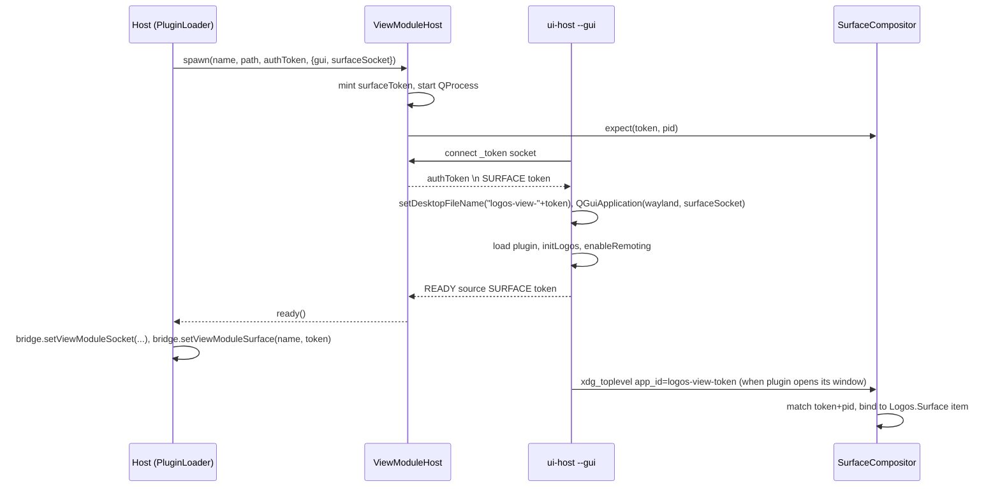

# RFC-2: Surface handshake between `ViewModuleHost` and `ui-host`

**Repository:** `logos-view-module-runtime` · **Status:** draft · **Depends on:** RFC-1 · **Needed by:** RFC-3, RFC-4

## Problem

Once a view module's backend renders into a Wayland toplevel (RFC-1 + RFC-4), the host
must know *which* toplevel on its nested compositor belongs to *which* module instance,
and must refuse any other client. The compositor sees only a socket connection, a pid and
an xdg `app_id`. The host already has a per-spawn secret channel (the `_token` local
socket, `src/ViewModuleHost.cpp:94–119`) and a per-spawn readiness line
(`READY <sourceName>`, `ui-host/main.cpp:311–314`); the handshake extends both.

## Proposal

### 1. Spawn options

```cpp
struct ViewSpawnOptions {
    bool gui = false;              // RFC-1 --gui
    QString surfaceSocket;         // RFC-1 --surface-socket; implies gui
};
bool ViewModuleHost::spawn(const QString& moduleName, const QString& pluginPath,
                           const QString& authToken,
                           const ViewSpawnOptions& options = {});
QString ViewModuleHost::surfaceToken() const;   // empty until ready(), or if !gui
qint64  ViewModuleHost::processId() const;      // for compositor pid matching
```

The three-argument `spawn` keeps working (default options).

### 2. Token minting

`ViewModuleHost` mints a **surface token** per spawn: 16 random bytes from
`QRandomGenerator::system()`, hex-encoded (32 chars). It is distinct from the auth
token (capability credential) and has no meaning outside the compositor.

### 3. Delivery

The surface token travels on the existing `_token` local socket, after the auth token,
as a second line:

```
<authToken>\n
SURFACE <surfaceToken>\n
```

`ui-host` today reads `client.readAll()` once (`main.cpp:187`). It is changed to read
until the socket closes, split on `\n`, take line 1 as the auth token and parse an
optional `SURFACE` line. A host that does not send the second line yields an empty
surface token (old host, new ui-host: fine). An old ui-host receiving two lines would
treat the whole payload as the auth token and fail credential adoption — so the host
only sends the second line when `options.gui` is set, which an old ui-host never gets
(`--gui` is unknown to it and `QCommandLineParser` rejects unknown options; the host
detects the exit and reports `surface.transport: none`).

### 4. `app_id`

Before constructing `QGuiApplication` (RFC-1), `ui-host` sets

```cpp
QGuiApplication::setDesktopFileName(QStringLiteral("logos-view-") + surfaceToken);
```

Qt's wayland client uses the desktop file name as the xdg-shell `app_id`. The compositor
(RFC-4) accepts a toplevel only if its `app_id` equals `logos-view-<token>` for a token
it has registered **and** the client's pid equals the `ViewModuleHost::processId()` that
registered it.

### 5. Readiness line

```
READY <sourceName> SURFACE <surfaceToken>
```

`ViewModuleHost` parses the optional `SURFACE` suffix (`src/ViewModuleHost.cpp:175–191`)
into `m_surfaceToken` before emitting `ready()`. Hosts that do not care ignore it.

### 6. Host-side accessor

`LogosQmlBridge::setViewModuleSurface(const QString& module, const QString& token)` and
`QString viewModuleSurfaceToken(const QString& module) const`, so that the host's
`Logos.Surface` item (RFC-3) can bind a module name to its surface without reaching into
`ViewModuleHost`. Neither is `Q_INVOKABLE` or a slot: the bridge is the `logos` context
property of sandboxed app QML, and -- as with the bridge's intent host-side API -- their
absence from the metaobject is what keeps the token out of app QML. `Logos.Surface`
resolves it inside the host from `module`. The token is dropped with the module
(`notifyViewModuleCrashed`).

## Sequence



## Security notes

- The token is per spawn and never written to disk, env or argv (argv is world-readable
  on Linux); it goes over the user-access-only local socket and `app_id`. `app_id` is
  visible to other clients of the *nested* compositor only, and the only clients the
  compositor admits are the ones the host spawned.
- Pid matching uses `wl_client_get_credentials` (`QWaylandClient::processId()`), which
  is kernel-asserted on Linux.

## Tests

- `tests/test_ui_host_gui.cpp` (shared with RFC-1): spawn with `{gui=true}` under
  offscreen, assert `surfaceToken()` is 32 hex chars after `ready()`, that the child set
  `app_id = logos-view-<token>` before the plugin ran (journalled from inside the child),
  that two spawns never share a token, that a plain spawn leaves it empty, and that the
  bridge accessors are absent from the metaobject.

## Status

Implemented in `logos-view-module-runtime` (workspace branch, M6a, amended in M6c).
Deviations from the draft:

- The bridge accessor is a plain C++ method, not `Q_INVOKABLE` (§6).
- `ViewModuleHost::surfaceToken()` returns the minted token as soon as `spawn()`
  returns, not only after `READY`: the compositor (RFC-4) must `expect()` the token
  before the child's first `wl_surface.commit`, which can precede the readiness line.
  `surfaceTokenConfirmed()` says whether the child echoed it back in `READY`.
- `ui-host --surface-socket` sets `QT_WAYLAND_DISABLE_WINDOWDECORATION=1`; Qt's
  client-side decoration would otherwise paint a title bar into the module's buffer.
- Basecamp binds the surface to its item by module name pinned per QML engine (RFC-3
  status) and uses the bridge accessor for the record only.
