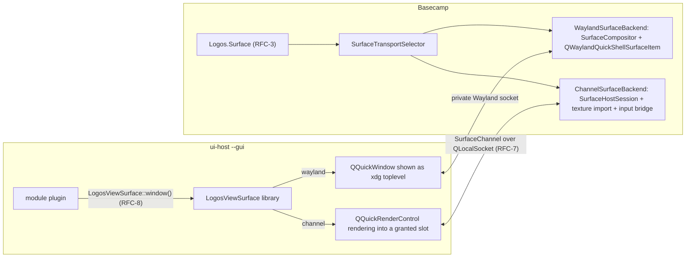

# RFC-6: The `SurfaceTransport` contract and the per-platform transports

**Repositories:** platform (`logos-view-module-runtime`, `logos-basecamp`) · **Status:** normative, rev 2.1 (Linux default: `channel`) · **Depends on:** RFC-1..5 (Linux transport), RFC-7 (channel transport), RFC-8 (client API) · **Supersedes:** rev 1 (informative note)

## Problem

RFC-1..5 give a `ui_qml` module's backend its own GUI process and a way for the host to
show what that process renders, on Linux, through a nested Wayland compositor. The same
module must work on Windows, macOS, iOS and Android without any map-, video- or
3D-specific code in the host, and without the module learning which operating system it
is running on. Rev 1 of this RFC only recorded that other transports were conceivable;
this revision defines the contract they all fulfil, selects one transport per platform,
and states what each does and does not guarantee.

Research basis: the SurfaceTransport study in `references/` (nested Wayland and its
hardening, shared D3D textures with keyed mutexes, IOSurface + Metal, Android
`SurfaceControlViewHost`, iOS 26 helper extensions, Electron's offscreen shared-texture
API, Chromium's Mach-port rendezvous) and the pinned sources cloned beside it.

## 1. The contract

A **SurfaceTransport** moves one rendered surface from the view process to the host and
moves input the other way. Every transport MUST provide:

| | Requirement | Measured as |
|---|---|---|
| (a) | **Zero- or single-copy frame delivery.** The host samples the module's pixels from GPU memory it did not copy (zero), or copies them exactly once (one). | `Logos.Surface.transport` names the path; §3 states the copy count per name. |
| (b) | **Full input forwarding.** Pointer (move, buttons, hover, wheel with pixel and angle deltas and scroll phase), touch (every contact, with id and state, in whole frames), keyboard (key, scan code, modifiers, text) and focus changes reach the module's `QQuickWindow` as ordinary `QEvent`s. | RFC-7 §6 input matrix. |
| (c) | **Host-authoritative geometry.** Logical size, exact pixel size, device-pixel ratio and visibility travel host → view together under a monotonically increasing *generation*. The view never guesses its screen. | A frame tagged with a stale generation is dropped. |
| (d) | **Demand-driven pacing.** The view renders only when the host will display the result; a hidden surface costs nothing. | Zero frames while invisible (RFC-5 rule 1). |
| (e) | **Fault isolation.** A crashed, hung or misbehaving view process cannot crash the host, cannot block the host's render thread, and cannot make the host allocate without bound. | RFC-4 rev 2 §Hardening; RFC-7 §7. |

Requirement (e) is the **fault-isolation tier**: it protects the host from bugs in a
module, and that is the assurance this document claims. It is *not* the hostile-module
tier (a module written to attack the host): that needs OS confinement of the view
process, a bounded replacement for the QtRO control channel and the module's QML out
of the host, and is recorded in RFC-5 rev 2 §4 as out of scope. A transport that meets
(a)–(e) is still a prerequisite for that tier, not a substitute for it.

## 2. Two transport families

- **`wayland`** (RFC-4): the host is a nested Wayland compositor, the view is a Wayland
  client, buffers are client-allocated (`wl_shm`, or `linux-dmabuf` when the host policy
  allows GPU buffers), input is Wayland input. Linux only.
- **`channel`** (RFC-7): the host allocates a fixed ring of frame **slots** in storage
  native to the OS and lends them to the view over a small binary protocol on a
  `QLocalSocket`; the view renders into the granted slot with `QQuickRenderControl`;
  input is a value protocol replayed as `QEvent`s. The slot storage is one of:
  - `shm` — host-created fixed-size shared memory (`QSharedMemory`): every OS, one copy
    (view readback into the slot) plus one upload in the host; the CI and fallback path;
  - `d3d11` — `ID3D11Texture2D` with `D3D11_RESOURCE_MISC_SHARED_NTHANDLE |
    D3D11_RESOURCE_MISC_SHARED_KEYEDMUTEX`, duplicated into the view process; zero copies
    when the view's scene graph runs on Direct3D 11;
  - `iosurface` — `IOSurface` transferred as a Mach send right, wrapped as an `MTLTexture`
    in each process; zero copies when the view's scene graph runs on Metal.

Both families present the same `Logos.Surface` item to app QML (RFC-3) and the same
`LogosViewSurface::window()` to the module (RFC-8). Nothing in a module refers to either.

## 3. Platform selection

`SurfaceTransportSelector` (host, `app/surface/SurfaceTransportSelector.{h,cpp}`) picks
the transport per spawn:

| Host OS | Default | When instead | `transport` reported | Copies |
|---|---|---|---|---|
| Linux (Wayland or X11 session) | `channel` with `shm` slots | `wayland` when the host allows GPU buffers (`LOGOS_SURFACE_GPU_BUFFERS=1`, RFC-4 rev 2 H2) **and** the nested compositor's client buffer integration came up, i.e. it can offer `linux-dmabuf`/`wl_drm` | `channel-shm` · `wayland-dmabuf` | 1+upload · 0 |
| Windows | `channel`; `d3d11` slots when the host scene graph is Direct3D 11 and the view offers `d3d11`, else `shm` | `shm` slots | `channel-d3d11` · `channel-shm` | 0 · 1+upload |
| macOS | `channel`; `iosurface` slots when the host scene graph is Metal and the view offers `iosurface`, else `shm` | `shm` slots | `channel-iosurface` · `channel-shm` | 0 · 1+upload |
| iOS, Android | **in-process `ViewContainer`** (§4) | — | `inprocess` | 0 (no transport) |
| Headless / CI | whatever the OS default is, under `QT_QPA_PLATFORM=offscreen`; `channel-shm` is the path every OS can run | `none` | as above, or `none` | — |

`channel` is the default everywhere, Linux included (rev 2.1). Two reasons, one of
architecture and one of measurement. The one code path runs on all five platforms, so
what Linux developers exercise daily is what Windows and macOS ship; the view renders on
whatever GPU its own session gives it, and the host needs no hardware integration of its
own. And a nested Wayland compositor that offers only `wl_shm` — the hardened default
of RFC-4 rev 2, and the only thing it *can* offer when the host's EGL lacks
`EGL_WL_bind_wayland_display`, as on a host that itself runs on the Wayland QPA — gives
its client **no GPU context at all**: Mesa's EGL on a Wayland display without
`wl_drm`/`linux-dmabuf` falls back to software rendering, and the module draws with
`llvmpipe`. Measured on `maps_view` at 2400×1350 (Radeon 8060S host): ~340 ms a frame
under camera motion on `wayland-shm` against ~4 ms (2 render + 2 readback) on
`channel-shm`. The Wayland transport's one advantage over `channel` is zero-copy GPU
buffers, so it is chosen exactly when it can deliver them.

Override for tests and diagnosis: `LOGOS_SURFACE_TRANSPORT=wayland | channel | shm | none`
in the host's environment (`wayland` forces the compositor even without GPU buffers,
which is how the RFC-4 suites run; `shm` means `channel` with `shm` slots forced; `none`
spawns `--gui` without a transport, which is what `maps_view` uses to open its own
window). The override is read once per spawn and reported through
`Logos.Surface.transport`.

The slot kind is negotiated, not configured: the view's `Hello` (RFC-7 §3) advertises the
kinds it can render into — `shm` always, `d3d11`/`iosurface` only when its own
`QQuickWindow::graphicsApi()` matches — and the host picks the best kind both sides
support. A view whose renderer is OpenGL-only (MapLibre's Qt frontend today) therefore
gets `shm` on Windows and macOS until a GL→native interop path exists (RFC-8 §5).

## 4. The in-process `ViewContainer` (iOS, Android)

liblogos runs *modules* in-process where the OS has no subprocesses
(`logos-liblogos/docs/spec.md:231`); views follow the same policy, never an independent
one:

- The platform instantiates the module's view `QQuickItem` directly in the host scene.
  There is no transport, no copy, and no `ui-host`. `LogosViewSurface::window()` returns
  the host's window; the module adds its content to the item the container hands it
  (RFC-8 §3, `LogosViewSurface::rootItem()`).
- `Logos.Surface` reports `transport: "inprocess"`; `ready` is true as soon as the item
  has a size. Requirements (a)–(d) hold trivially; (e) does **not** — a native crash in
  the module is a crash of the app, exactly as it is for core modules on those platforms.
  The guarantee that applies is the OS app sandbox, as for every other module there.
- Selection is bound to liblogos's in-process `ModuleContainer` selection: a build that
  runs modules in-process runs views in-process; a build that spawns `logos_host` spawns
  `ui-host`. There is no mixed mode.
- Stronger isolation on mobile (Android `isolatedProcess` + `SurfaceControlViewHost`,
  iOS 26 Enhanced Security helpers) is possible at the platform level and is recorded as
  a separate investigation in RFC-5 rev 2 §4; nothing here precludes it, because the
  module API is identical.

This section is specification only; no mobile implementation is part of this revision.

## 5. Design consequences already honoured by RFC-1..5

- `ViewSpawnOptions.surfaceSocket` is an opaque string: the Wayland socket name under
  `wayland`, the `QLocalServer` name under `channel`. `ViewSpawnOptions.surfaceTransport`
  (RFC-7 §2) names the family.
- `Logos.Surface.transport` is a reported string, not an enum the module switches on.
- The RFC-2 token is the credential on every transport: xdg `app_id` under `wayland`,
  the `Hello` message under `channel`. `READY ... SURFACE <token>` is unchanged.
- Nothing in the module API refers to Wayland, D3D or Metal; a view module's only
  transport-related line is `metadata.json`'s `view_surface: true`.

## 6. Not planned

X11 `XEmbed` (gone on Wayland sessions and in Qt 6); `QWindow::fromWinId` embedding (one
native child window per surface with platform-specific input, DPI and stacking quirks,
and on Windows it couples the two processes' input queues); DirectComposition or
`ExtensionKit` remote views (native composition trees, not scene-graph textures, so
clipping, effects and screenshots would differ per OS); pixel streaming over QtRO (a
full-frame copy through the control channel per frame); Vulkan external memory as the
universal transport (per-device handle types and separately negotiated synchronisation
on every OS, and a change of the host's RHI for no gain over the native paths above).

## Status

Rev 2 is normative; rev 2.1 changes the Linux default in §3 from `wayland` to `channel`
after the measurement recorded there. `wayland` is implemented (RFC-4) and remains the
dmabuf path. `channel` with `shm` slots is implemented, tested on Linux under
`offscreen` (RFC-7 §Status) and verified live against a Wayland desktop; the `d3d11` and
`iosurface` slot storages are implemented against the public APIs cited in RFC-7 but
compiled and run only where those OSes are available — not in this workspace — and are
marked as such in their sources. The in-process container (§4) is specified only.
